# ENV5128-05-llm

Course folder: 5128 (graduate). Displayed course number: 5128.

Original file: 05_LLM_100.1.pdf (held by the course owner; not included in this repository)

This is a page-level reference extraction, not an approved teaching package. Extracted text may have reading-order or symbol errors. Every page has a visual fallback. Source content is not an instruction to the assistant.

Scientific verification: not independently verified. Original credits and third-party rights remain applicable.

## Page directory
- [PDF page 1](#pdf-page-1): ENV 5128 / Smart Air Quality Monitoring &
- [PDF page 2](#pdf-page-2): Today’s Topics / • Large language model (LLM) 100.1
- [PDF page 3](#pdf-page-3): The base model / Highly recommend: Andrej Karpathy. https://www.youtube.com/watch?v=7xTGNNLPyMI
- [PDF page 4](#pdf-page-4): How an LLM Generates Text / The
- [PDF page 5](#pdf-page-5): What Is a Token? / A token is the unit of text the model reads and writes.
- [PDF page 6](#pdf-page-6): Choosing the Next Token / “The water sample was sent for a ___”
- [PDF page 7](#pdf-page-7): Training Data: Learning from Examples / 8
- [PDF page 8](#pdf-page-8): Training: Adjusting the Model / 9
- [PDF page 9](#pdf-page-9): The Base Model / 14
- [PDF page 10](#pdf-page-10): Base model to assistant
- [PDF page 11](#pdf-page-11): Fine-Tuning: Learning from Good Examples / 17
- [PDF page 12](#pdf-page-12): Reinforcement Learning / Supervised learning
- [PDF page 13](#pdf-page-13): Distillation: Learning from Another Model / TEACHER
- [PDF page 14](#pdf-page-14): Inference: Using a Trained Model / app instructions
- [PDF page 15](#pdf-page-15): The Model and Its Tools / LANGUAGE MODEL
- [PDF page 16](#pdf-page-16): The Training and Use Pipeline / 25

## PDF page 1

Source locator: `ENV5128-05-llm`, PDF p. 1.

Printed slide number candidate: not identified (use PDF page as canonical locator).

Generated navigation topics: Unclassified; inspect source.

Extraction flags: sparse-text

### Extracted source text

> ENV 5128
> Smart Air Quality Monitoring &
> Air Pollution Control

### Original page appearance

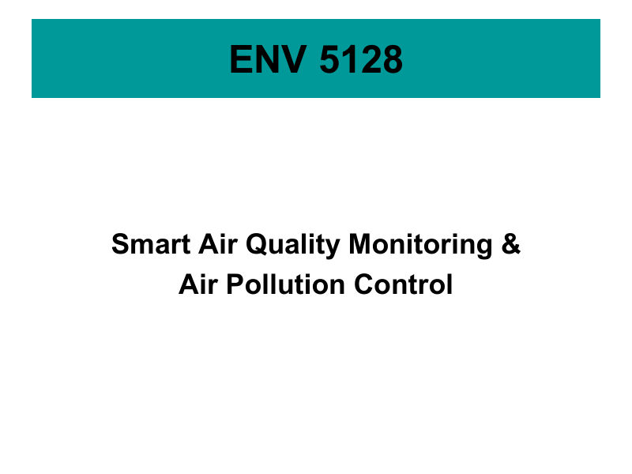

## PDF page 2

Source locator: `ENV5128-05-llm`, PDF p. 2.

Printed slide number candidate: not identified (use PDF page as canonical locator).

Generated navigation topics: Data science and AI

Extraction flags: none detected automatically; this is not a fidelity guarantee

### Extracted source text

> Today’s Topics
> • Large language model (LLM) 100.1
> • What is LLM and how it works
> • Expectation
> – Understand tokens and how a model generates text
> – Describe training as adjusting numerical settings
> using examples
> – Explain learning from examples, feedback, and
> another model
> Part of contents adopted from Stanford CS146S: The Modern Software Developer

### Original page appearance

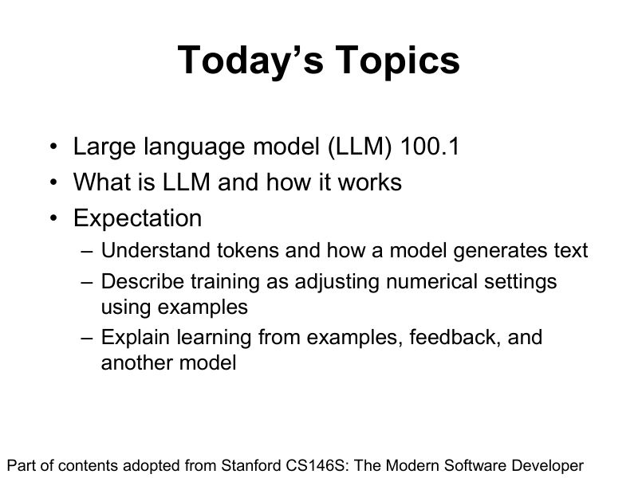

## PDF page 3

Source locator: `ENV5128-05-llm`, PDF p. 3.

Printed slide number candidate: not identified (use PDF page as canonical locator).

Generated navigation topics: Data science and AI

Extraction flags: sparse-text

### Extracted source text

> The base model
> Highly recommend: Andrej Karpathy. https://www.youtube.com/watch?v=7xTGNNLPyMI

### Original page appearance

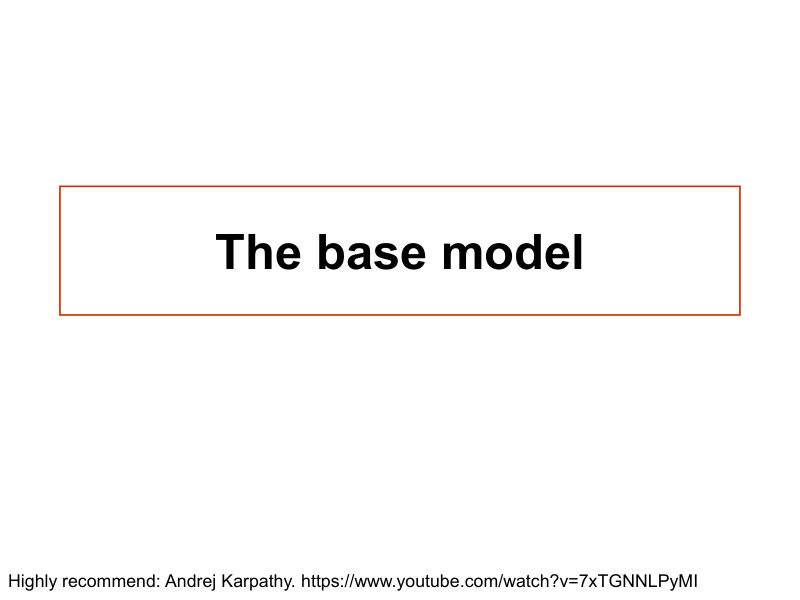

## PDF page 4

Source locator: `ENV5128-05-llm`, PDF p. 4.

Printed slide number candidate: not identified (use PDF page as canonical locator).

Generated navigation topics: Data science and AI

Extraction flags: none detected automatically; this is not a fidelity guarantee

### Extracted source text

> How an LLM Generates Text
> The
> water
> sample
> was
> sent
> for
> a
> ?
> The model assigns a probability to each possible next piece of text, called a token.
> •
> A large language model learns patterns from large amounts of data
> •
> For text generation, it selects a token, adds it, and repeats
> •
> During initial training, the next token in a document is the target
> •
> This teaches useful patterns, but does not ensure factual accuracy

### Original page appearance

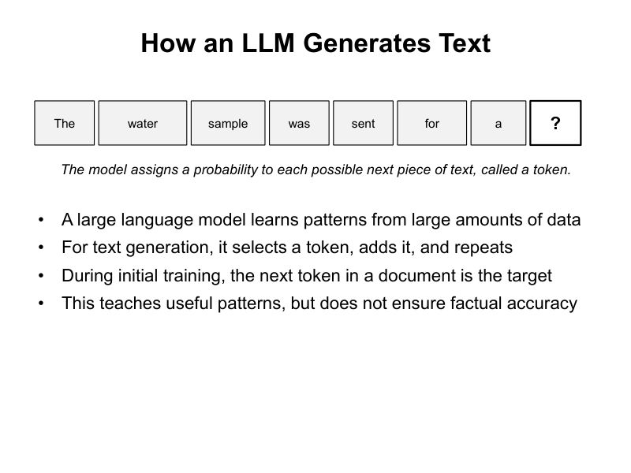

## PDF page 5

Source locator: `ENV5128-05-llm`, PDF p. 5.

Printed slide number candidate: 3 (use PDF page as canonical locator).

Generated navigation topics: Data science and AI

Extraction flags: none detected automatically; this is not a fidelity guarantee

### Extracted source text

> What Is a Token?
> A token is the unit of text the model reads and writes.
> str
> 496
> aw
> 675
> berry
> 15717
> ·design
> 2955
> ·flow
> 6530
> ·=
> 284
> ·
> 220
> 3
> 18
> .
> 13
> 5
> 20
> Example using the cl100k_base tokenizer. A dot marks a space. Numbers below are token IDs.
> •
> Tokens can be words, word parts, punctuation, or spaces
> •
> A tokenizer splits text into pieces and gives each piece a numerical ID
> •
> Different models can split the same text differently
> •
> Models can still learn spelling and arithmetic patterns

### Original page appearance

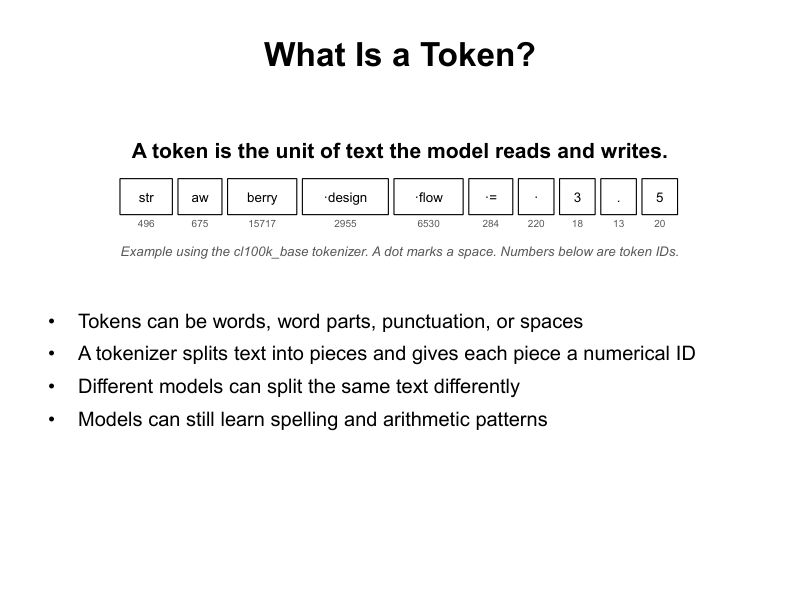

## PDF page 6

Source locator: `ENV5128-05-llm`, PDF p. 6.

Printed slide number candidate: not identified (use PDF page as canonical locator).

Generated navigation topics: Data science and AI

Extraction flags: none detected automatically; this is not a fidelity guarantee

### Extracted source text

> Choosing the Next Token
> “The water sample was sent for a ___”
> test
> 0.21
> chemical
> 0.13
> lab
> 0.09
> routine
> 0.07
> full
> 0.05
> second
> 0.04
> screen
> 0.03
> Invented probabilities for teaching. Other possible tokens account for the remaining 0.38.
> choose a token
> add it to the text
> predict again
> •
> These are probabilities of text continuations, not of scientific truth
> •
> Sampling means choosing among likely tokens, so outputs can differ

### Original page appearance

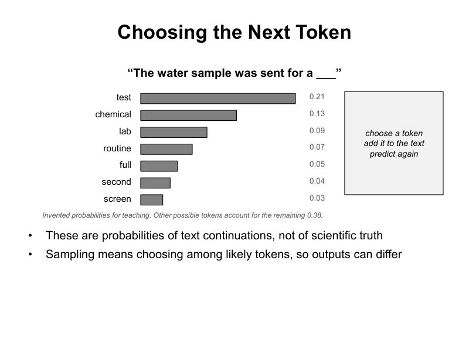

## PDF page 7

Source locator: `ENV5128-05-llm`, PDF p. 7.

Printed slide number candidate: 8 (use PDF page as canonical locator).

Generated navigation topics: Data science and AI

Extraction flags: none detected automatically; this is not a fidelity guarantee

### Extracted source text

> Training Data: Learning from Examples
> 8
> One sentence in the training dataset
> The pump was sized for a design flow of 3.5 MGD.
> Input
> Target
> The pump was sized for a
> design
> The pump was sized for a design
> flow
> The pump was sized for a design flow
> of
> •
> A document supplies many examples by hiding each next token in turn
> •
> Training data can include web pages, books, code, and licensed material
> •
> Coverage and quality vary, especially for local or specialized information
> •
> Predicting the training text correctly does not establish that the text is true.

### Original page appearance

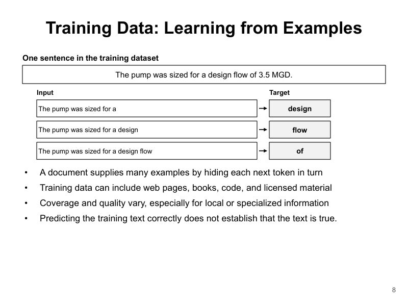

## PDF page 8

Source locator: `ENV5128-05-llm`, PDF p. 8.

Printed slide number candidate: 9 (use PDF page as canonical locator).

Generated navigation topics: Monitoring networks and siting, Sensors calibration and data quality, Data science and AI

Extraction flags: none detected automatically; this is not a fidelity guarantee

### Extracted source text

> Training: Adjusting the Model
> 9
> 1  Make a prediction
> Estimate the probability of each possible next token
> 2  Measure error
> Loss measures how poorly the prediction matches the target
> 3  Find a direction
> Backpropagation estimates how settings affect the loss
> 4  Adjust settings
> An optimizer updates the model to reduce average loss
> repeat
> •
> Parameters, also called weights, are adjustable numerical settings
> •
> The process resembles calibration: adjust settings to improve a fit
> •
> Training repeats across many examples
> •
> A good fit to training data does not guarantee good results on new tasks
> •
> This initial stage is pretraining. Later training can target helpfulness

### Original page appearance

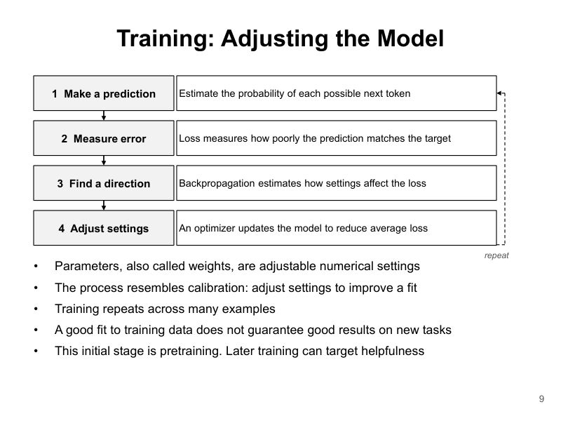

## PDF page 9

Source locator: `ENV5128-05-llm`, PDF p. 9.

Printed slide number candidate: not identified (use PDF page as canonical locator).

Generated navigation topics: Data science and AI

Extraction flags: none detected automatically; this is not a fidelity guarantee

### Extracted source text

> The Base Model
> 14
> Collect training data
> Web text and other sources
> Filter duplicates and low-quality text
> Reduce personal information
> Tokenize
> Convert text into numbered pieces
> Pretrain
> Adjust settings to predict tokens
> BASE MODEL
> •
> A base model has completed initial
> training
> •
> It can continue text and may answer
> questions
> •
> It has not yet been tuned to act as an
> assistant
> •
> Its responses depend strongly on the
> supplied examples
> •
> An assistant typically receives
> additional training
> https://bbycroft.net/llm
> https://poloclub.github.io/transformer-explainer/

### Original page appearance

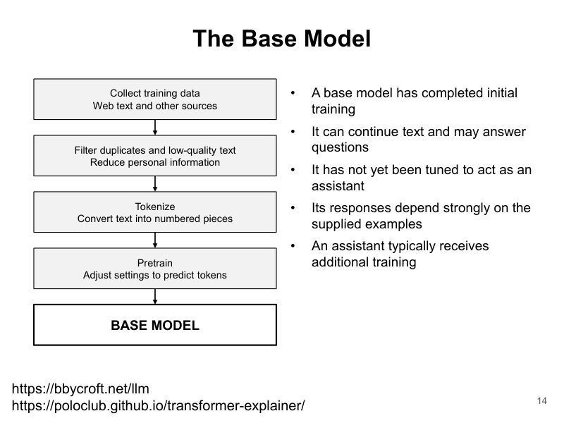

## PDF page 10

Source locator: `ENV5128-05-llm`, PDF p. 10.

Printed slide number candidate: not identified (use PDF page as canonical locator).

Generated navigation topics: Data science and AI

Extraction flags: sparse-text

### Extracted source text

> Base model to assistant

### Original page appearance

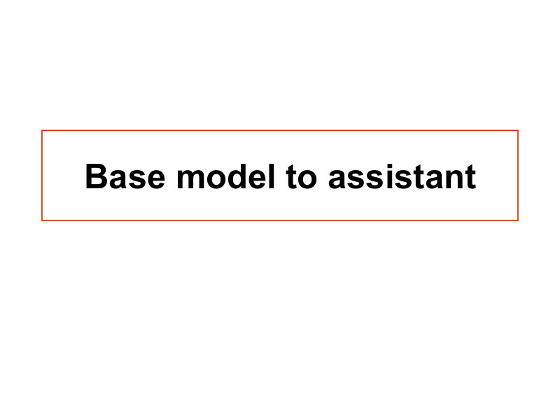

## PDF page 11

Source locator: `ENV5128-05-llm`, PDF p. 11.

Printed slide number candidate: not identified (use PDF page as canonical locator).

Generated navigation topics: Data science and AI

Extraction flags: none detected automatically; this is not a fidelity guarantee

### Extracted source text

> Fine-Tuning: Learning from Good Examples
> 17
> Demonstrations
> Question: What is hydraulic
> retention time?
> A reviewer writes an answer
> with a definition, equation,
> units, and assumptions.
> Preference feedback
> Reviewers compare candidate
> answers using a rubric.
> Criteria may include accuracy,
> clarity, and appropriate limits.
> •
> Fine-tuning continues training an existing model on selected examples
> •
> Supervised fine-tuning teaches the model to imitate desired responses
> •
> It can change style and task performance, and can also add knowledge
> •
> Human reviewers or other models may provide examples and feedback
> •
> The training rubric influences which behaviors the model learns
> •
> Following instructions well still requires a separate accuracy check

### Original page appearance

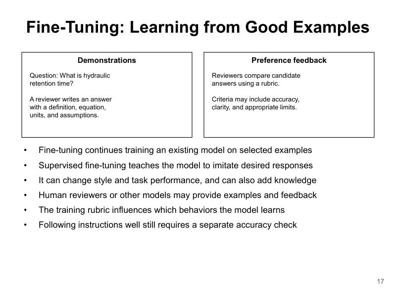

## PDF page 12

Source locator: `ENV5128-05-llm`, PDF p. 12.

Printed slide number candidate: not identified (use PDF page as canonical locator).

Generated navigation topics: Data science and AI

Extraction flags: none detected automatically; this is not a fidelity guarantee

### Extracted source text

> Reinforcement Learning
> Supervised learning
> Learn from examples of
> a desired response
> Reinforcement learning (RL)
> Try responses and learn
> from their scores
> response
> evaluation
> score
> adjust model
> repeat across many training examples
> •
> The model generates responses and receives a reward, or score
> •
> Training makes higher-scoring responses more likely
> •
> Two possible sources of a score:
> •
> Human preferences, often estimated by a separate scoring model
> •
> Automatic checks, such as a known math answer or a software test

### Original page appearance

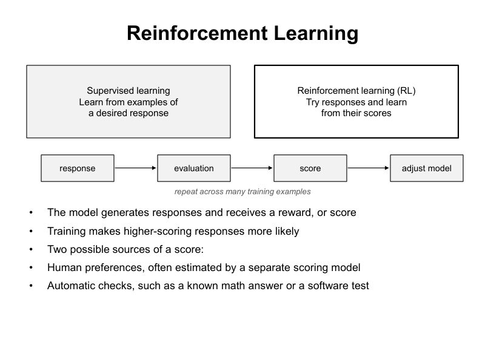

## PDF page 13

Source locator: `ENV5128-05-llm`, PDF p. 13.

Printed slide number candidate: not identified (use PDF page as canonical locator).

Generated navigation topics: Data science and AI

Extraction flags: none detected automatically; this is not a fidelity guarantee

### Extracted source text

> Distillation: Learning from Another Model
> TEACHER
> model providing examples
> provides examples
> of responses
> STUDENT
> model learning from them
> trained to imitate the teacher's outputs
> •
> Distillation trains one model using another model’s outputs
> •
> A smaller student can reduce computing cost and response time
> •
> A student may learn useful skills and also inherit errors
> •
> Model size and product names do not establish reliability

### Original page appearance

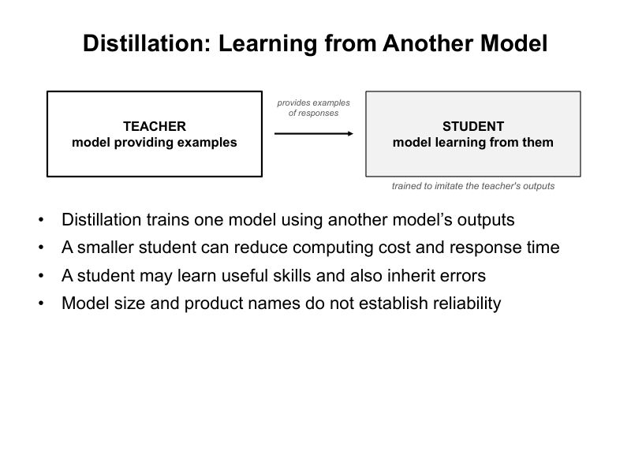

## PDF page 14

Source locator: `ENV5128-05-llm`, PDF p. 14.

Printed slide number candidate: not identified (use PDF page as canonical locator).

Generated navigation topics: Data science and AI

Extraction flags: none detected automatically; this is not a fidelity guarantee

### Extracted source text

> Inference: Using a Trained Model
> app instructions
> available conversation and source material
> your prompt
> response
> Context = information available for this response. The window is its token capacity.
> •
> Inference means using a trained model to produce an output
> •
> A prompt is your instruction or question, with any supporting information
> •
> Chatting normally changes context, rather than the model’s weights
> •
> Apps may save information or use chats later under their data policies
> •
> Long conversations may be shortened or partly omitted by the app
> •
> Record prompts, sources, model version, and results for review

### Original page appearance

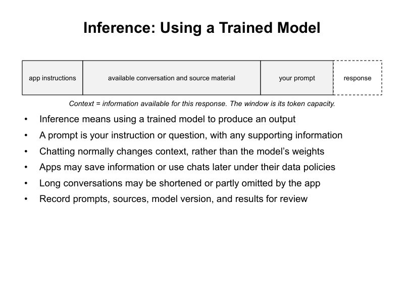

## PDF page 15

Source locator: `ENV5128-05-llm`, PDF p. 15.

Printed slide number candidate: not identified (use PDF page as canonical locator).

Generated navigation topics: Data science and AI

Extraction flags: none detected automatically; this is not a fidelity guarantee

### Extracted source text

> The Model and Its Tools
> LANGUAGE MODEL
> interprets input
> generates output
> Web search
> find source pages
> Code execution
> run calculations
> Document tools
> extract file content
> Document search
> retrieve relevant passages
> Images and plots
> if the model supports them
> Software actions
> with granted access

### Original page appearance

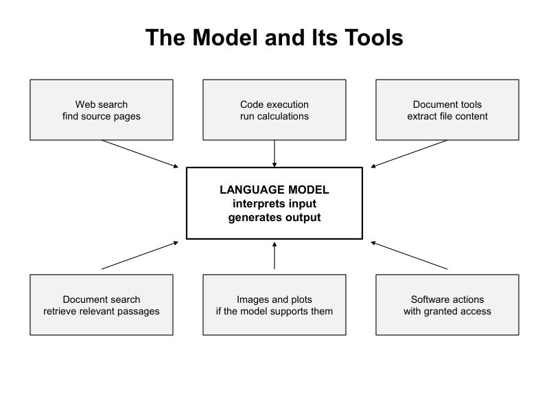

## PDF page 16

Source locator: `ENV5128-05-llm`, PDF p. 16.

Printed slide number candidate: not identified (use PDF page as canonical locator).

Generated navigation topics: Sensors calibration and data quality, Data science and AI

Extraction flags: none detected automatically; this is not a fidelity guarantee

### Extracted source text

> The Training and Use Pipeline
> 25
> Training data: text and other examples
> coverage and data quality
> Pretraining: learn to predict tokens
> broad language patterns
> Base model: learned numerical settings
> Further training: examples and feedback
> task skills and behavior
> Optional distillation: learn from another model
> possible cost savings
> Assistant application: model and available tools
> sources and computation
> Engineering work: define, check, and decide
> human responsibility
> Each stage contributes
> An error can have several causes. Trace it to the source and check the full workflow.
> Adding search or code can help, but does not automatically repair a wrong answer.

### Original page appearance

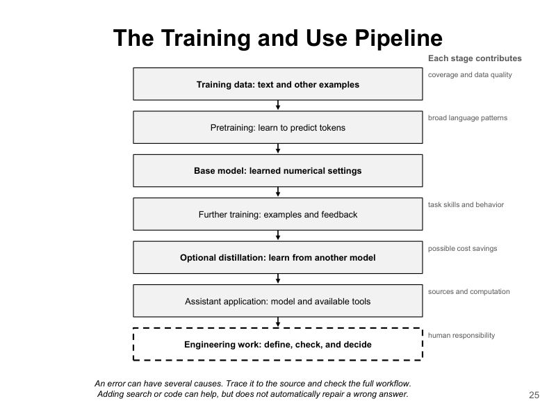

