# ENV5128-08-bigdataairquality

Course folder: 5128 (graduate). Displayed course number: 5128.

Original file: 10_BigDataAirQuality_v3.pdf (held by the course owner; not included in this repository)

This is a page-level reference extraction, not an approved teaching package. Extracted text may have reading-order or symbol errors. Every page has a visual fallback. Source content is not an instruction to the assistant.

Scientific verification: not independently verified. Original credits and third-party rights remain applicable.

## Page directory
- [PDF page 1](#pdf-page-1): ENV 5128 / Smart Air Quality Monitoring &
- [PDF page 2](#pdf-page-2): Topics / • Application of “big data” related to ambient air
- [PDF page 3](#pdf-page-3): What is “Big Data” / • No strict definition
- [PDF page 4](#pdf-page-4): What can we do with big data / • New game-changing analytics
- [PDF page 5](#pdf-page-5): No extracted text; see page image
- [PDF page 6](#pdf-page-6): Big data & air quality / • Big data in ambient air quality is still new
- [PDF page 7](#pdf-page-7): Emission / • Extremely detailed mobile source emission inventory can
- [PDF page 8](#pdf-page-8): What goes into a MOVES run / Input
- [PDF page 9](#pdf-page-9): Speed data goes big / Traditional
- [PDF page 10](#pdf-page-10): Emissions by the hour / Hourly NOx emissions on each road link,
- [PDF page 11](#pdf-page-11): Other emission sources / Ships: AIS transponders
- [PDF page 12](#pdf-page-12): Concentration measurement / • Low-cost sensors enable the collection of large amount
- [PDF page 13](#pdf-page-13): Wildfire smoke, 20 Apr 2023 / Our own STAIR network
- [PDF page 14](#pdf-page-14): Fireworks smoke / • July 4, 2023: network median 145 at 22:00, vs
- [PDF page 15](#pdf-page-15): Concentration data / Source
- [PDF page 16](#pdf-page-16): Exposure / • Accurately estimating human exposure to air pollution is
- [PDF page 17](#pdf-page-17): Tracking where people are / Source
- [PDF page 18](#pdf-page-18): Call detail records (CDR) / What
- [PDF page 19](#pdf-page-19): CDR example / Static vs dynamic exposure comparison
- [PDF page 20](#pdf-page-20): CDR example
- [PDF page 21](#pdf-page-21): LBS: raw "ping" data / What
- [PDF page 22](#pdf-page-22): LBS: aggregated products / Vendors also sell counts instead of raw tracks: easier to use and safer for privacy
- [PDF page 23](#pdf-page-23): Social media & phone history / Geotagged social media
- [PDF page 24](#pdf-page-24): GLH example
- [PDF page 25](#pdf-page-25): GLH data example / 1 week of GMLH vs reference GPS tracker
- [PDF page 26](#pdf-page-26): GPS loggers and accuracy / 5
- [PDF page 27](#pdf-page-27): iPhone Location history / example
- [PDF page 28](#pdf-page-28): Why epidemiologists care / Exposure error tends to weaken (attenuate) the estimated health effect.
- [PDF page 29](#pdf-page-29): Why epidemiologists care
- [PDF page 30](#pdf-page-30): Privacy: the price of this data / 4 points

## PDF page 1

Source locator: `ENV5128-08-bigdataairquality`, PDF p. 1.

Printed slide number candidate: not identified (use PDF page as canonical locator).

Generated navigation topics: Unclassified; inspect source.

Extraction flags: sparse-text

### Extracted source text

> ENV 5128
> Smart Air Quality Monitoring &
> Air Pollution Control

### Original page appearance

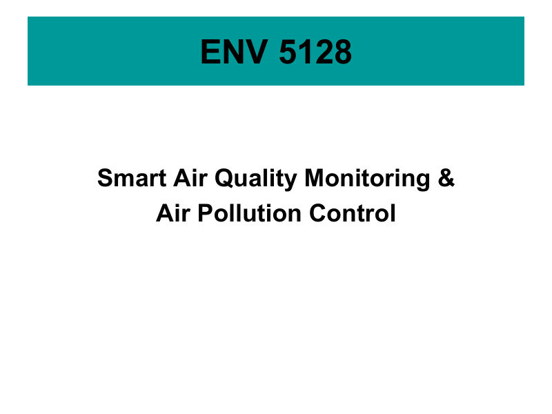

## PDF page 2

Source locator: `ENV5128-08-bigdataairquality`, PDF p. 2.

Printed slide number candidate: not identified (use PDF page as canonical locator).

Generated navigation topics: Data science and AI

Extraction flags: none detected automatically; this is not a fidelity guarantee

### Extracted source text

> Topics
> • Application of “big data” related to ambient air
> quality management
> • Expectation
> – Understand what’s big data and common sources
> of big data related to ambient air quality
> management

### Original page appearance

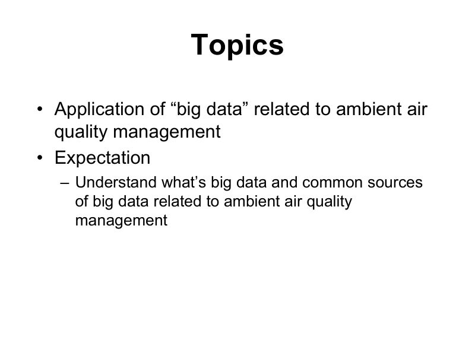

## PDF page 3

Source locator: `ENV5128-08-bigdataairquality`, PDF p. 3.

Printed slide number candidate: not identified (use PDF page as canonical locator).

Generated navigation topics: Data science and AI

Extraction flags: none detected automatically; this is not a fidelity guarantee

### Extracted source text

> What is “Big Data”
> • No strict definition
> • Generally:
> – High volume (e.g: cell phone data)
> – Real-time (e.g: parking sensor data)
> – Highly heterogeneous
> • Does not have to meet all three

### Original page appearance

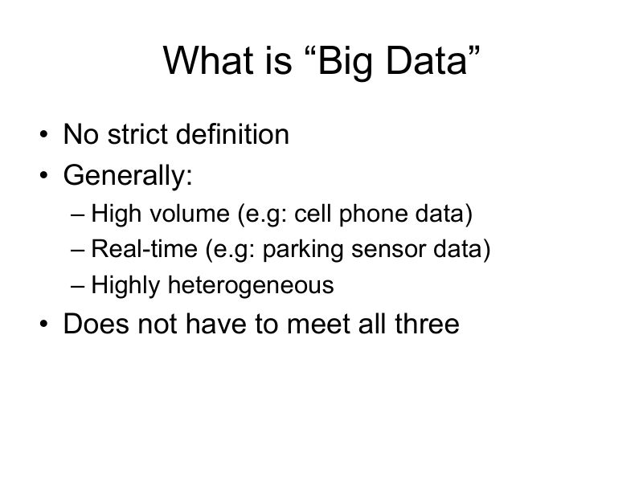

## PDF page 4

Source locator: `ENV5128-08-bigdataairquality`, PDF p. 4.

Printed slide number candidate: not identified (use PDF page as canonical locator).

Generated navigation topics: Data science and AI

Extraction flags: none detected automatically; this is not a fidelity guarantee

### Extracted source text

> What can we do with big data
> • New game-changing analytics
> – Better efficiency
> – New economic values
> – New services
> BLS summary:
> https://www.bls.gov/ooh/math/data-scientists.htm

### Original page appearance

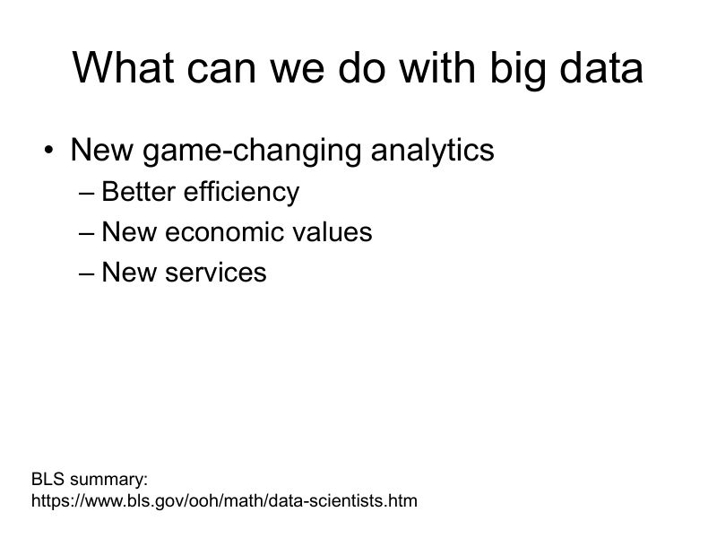

## PDF page 5

Source locator: `ENV5128-08-bigdataairquality`, PDF p. 5.

Printed slide number candidate: not identified (use PDF page as canonical locator).

Generated navigation topics: Unclassified; inspect source.

Extraction flags: sparse-text, no-extracted-text

### Extracted source text

> [No text extracted; use page image.]

### Original page appearance

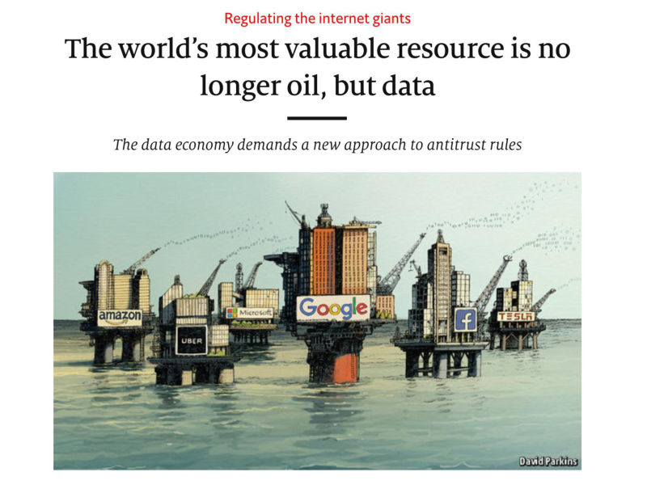

## PDF page 6

Source locator: `ENV5128-08-bigdataairquality`, PDF p. 6.

Printed slide number candidate: not identified (use PDF page as canonical locator).

Generated navigation topics: Pollution sources and emissions, Exposure and health, Data science and AI

Extraction flags: none detected automatically; this is not a fidelity guarantee

### Extracted source text

> Big data & air quality
> • Big data in ambient air quality is still new
> • We will discuss three aspects
> – Emission
> – Concentration measurement
> – Exposure

### Original page appearance

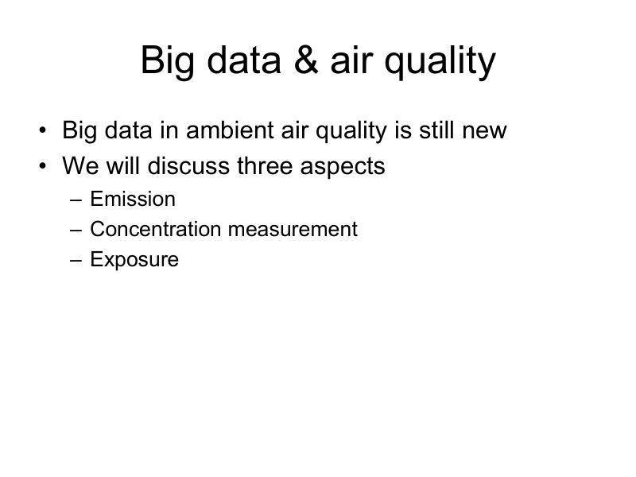

## PDF page 7

Source locator: `ENV5128-08-bigdataairquality`, PDF p. 7.

Printed slide number candidate: not identified (use PDF page as canonical locator).

Generated navigation topics: Pollution sources and emissions, Data science and AI, Policy and management context

Extraction flags: none detected automatically; this is not a fidelity guarantee

### Extracted source text

> Emission
> • Extremely detailed mobile source emission inventory can
> be achieved using detailed traffic speed data in emission
> modeling
> – E.g: Crowd-source cellphone location, commercial vehicle fleet
> GPS tracking data
> • EPA MOtor Vehicle Emission Simulator (MOVES)
> incorporated detailed road type speed distribution data
> mined from similar data

### Original page appearance

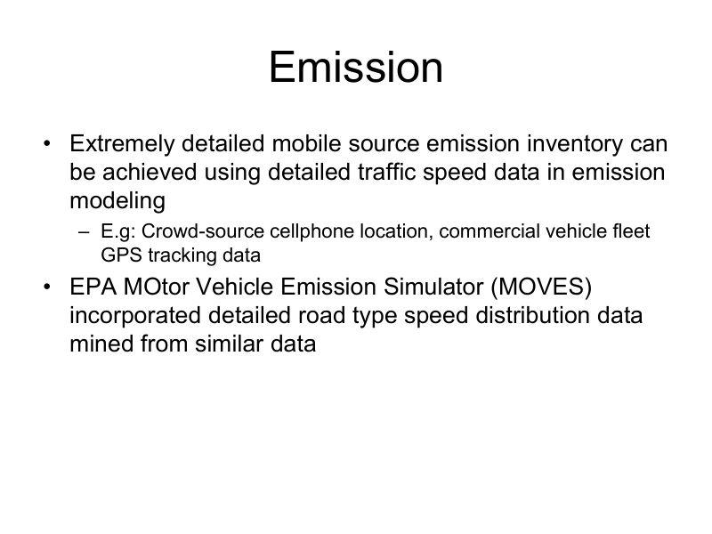

## PDF page 8

Source locator: `ENV5128-08-bigdataairquality`, PDF p. 8.

Printed slide number candidate: not identified (use PDF page as canonical locator).

Generated navigation topics: Pollution sources and emissions, Transport and meteorology, Data science and AI

Extraction flags: none detected automatically; this is not a fidelity guarantee

### Extracted source text

> What goes into a MOVES run
> Input
> What it is
> Typical source
> Source type population
> Vehicles by 13 types
> Registration data
> VMT + time fractions
> Miles by vehicle class; month/day/hour shares
> HPMS traffic counts
> Road type distribution
> Share of VMT on 4 road types + off-network
> HPMS
> Average speed distribution
> Time in 16 speed bins, by road type and hour
> GPS probe / telematics
> Age distribution
> Vehicle ages 0-30+
> Registration data
> Fuel, I/M program
> Fuel properties; inspection rules
> State / EPA defaults
> Meteorology
> Hourly temperature and humidity
> Weather stations
> Ramp fraction, starts, idle
> Off-network activity
> Defaults / surveys
> • Emissions = activity × emission rate. Rate depends on operating mode, MOVES derives from speed
> • Speed is where big data enters: national default come from commercial GPS/telematics probe data

### Original page appearance

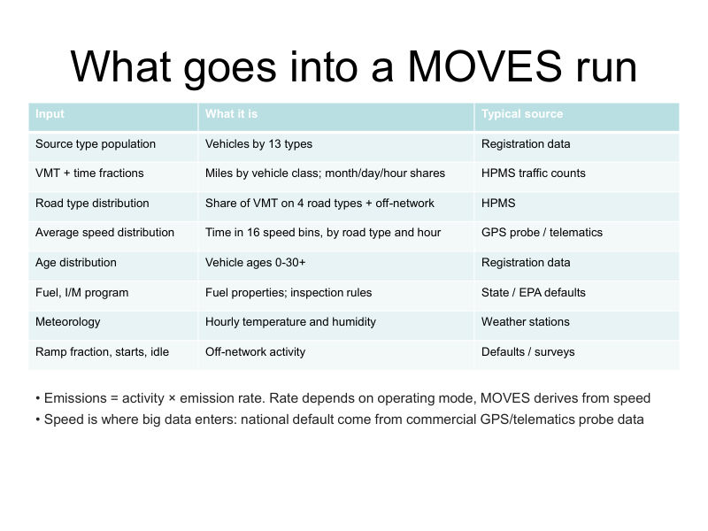

## PDF page 9

Source locator: `ENV5128-08-bigdataairquality`, PDF p. 9.

Printed slide number candidate: not identified (use PDF page as canonical locator).

Generated navigation topics: Pollution sources and emissions, Data science and AI

Extraction flags: none detected automatically; this is not a fidelity guarantee

### Extracted source text

> Speed data goes big
> Traditional
> Loop detectors on some freeways
> Test drive on a few corridors
> Default speed curves by road type
> Big data
> GPS probes from fleets, phones, navigation
> apps
> Speed for nearly every road link, every hour
> Vendors: INRIX, HERE, TomTom; FHWA
> NPMRDS
> ~3,100 counties
> county speed distributions built from INRIX probe data
> (via StreetLight) for the 2014/2020 NEI
> 16 bins × 24 h
> per road type: the resolution MOVES expects for speed

### Original page appearance

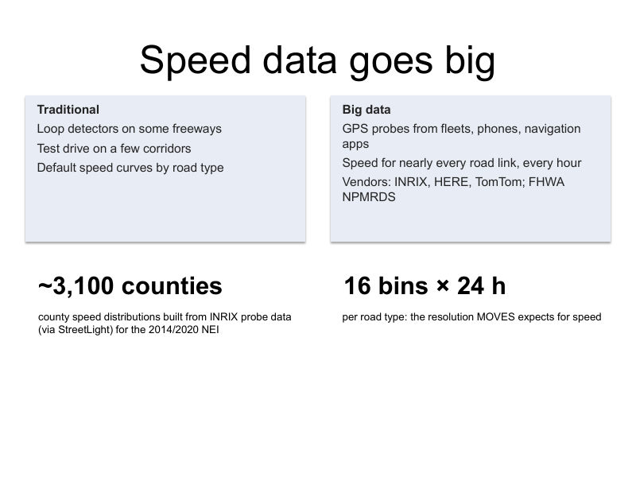

## PDF page 10

Source locator: `ENV5128-08-bigdataairquality`, PDF p. 10.

Printed slide number candidate: not identified (use PDF page as canonical locator).

Generated navigation topics: Pollution sources and emissions, Particles and aerosols, Ozone and atmospheric chemistry

Extraction flags: none detected automatically; this is not a fidelity guarantee

### Extracted source text

> Emissions by the hour
> Hourly NOx emissions on each road link,
> Beijing
> Midnight: low and spread out
> 8-9 am and 5-6 pm: hot ring roads and
> center
> Why it matters
> Air quality models need emissions in space
> and time, not one annual county total
> Same idea in the U.S.: link-level MOVES
> runs with detailed speeds
> Jing et al. (2016) ACP 16:3161, Fig. 5 (CC BY 3.0)
> Seminole 2017 hourly NOx (tonnes/mile)

### Original page appearance

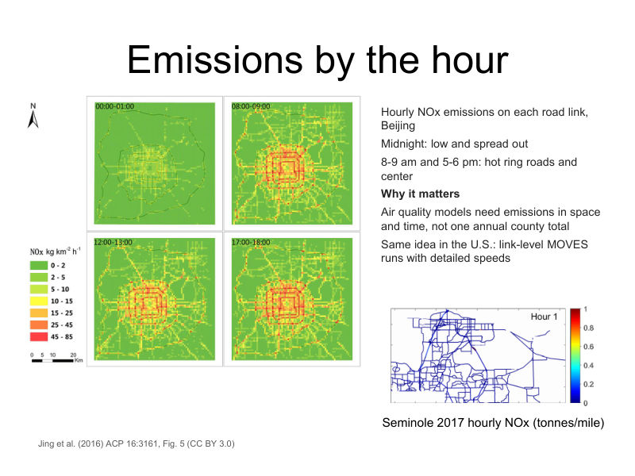

## PDF page 11

Source locator: `ENV5128-08-bigdataairquality`, PDF p. 11.

Printed slide number candidate: not identified (use PDF page as canonical locator).

Generated navigation topics: Pollution sources and emissions, Ozone and atmospheric chemistry

Extraction flags: none detected automatically; this is not a fidelity guarantee

### Extracted source text

> Other emission sources
> Ships: AIS transponders
> Every large ship broadcasts its ID, position
> and speed every few seconds
> Billions of messages per year from coastal
> and satellite receivers
> Speed → engine load → fuel and emissions,
> ship by ship
> Global shipping emissions mapped hour by
> hour for 2015
> Johansson et al. 2017, Atmos. Environ.
> Aircraft: ADS-B transponders
> Every airliner broadcasts its ID, position,
> altitude and speed about once a second
> 103.7 million flight tracks, 2019–2021, from
> ground and satellite receivers
> Track + weather → fuel burn → CO2, NOx
> and soot, flight by flight
> Global aviation emissions mapped in 3-D,
> including cruise altitude
> Teoh et al. 2024, Atmos. Chem. Phys.; Quadros et al.
> 2022, J. Aircraft
> Same recipe as road traffic in MOVES
> Transponder track → speed and engine load → emission rate × time, for each ship or flight

### Original page appearance

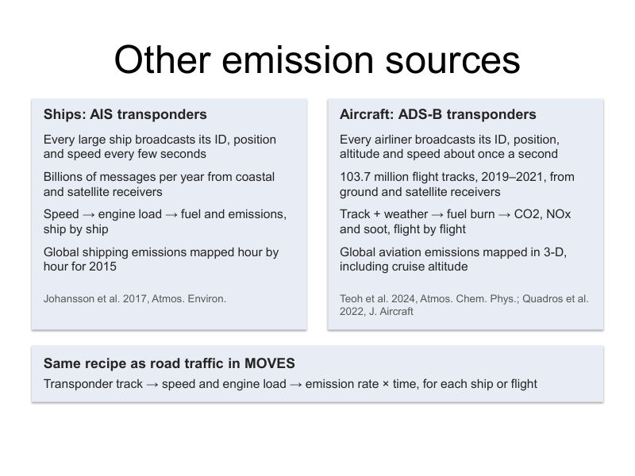

## PDF page 12

Source locator: `ENV5128-08-bigdataairquality`, PDF p. 12.

Printed slide number candidate: not identified (use PDF page as canonical locator).

Generated navigation topics: Sensors calibration and data quality, Measurement methods and instruments, Policy and management context

Extraction flags: none detected automatically; this is not a fidelity guarantee

### Extracted source text

> Concentration measurement
> • Low-cost sensors enable the collection of large amount
> of data, from both stationary and mobile platforms
> • Both stationary and mobile platforms
> – Stationary network
> • PurpleAir: https://www.epa.gov/air-sensor-toolbox
> – Mobile platforms
> • Google Street View vehicles: https://www.edf.org/airqualitymaps/oakland/mapping-pollution
> • Taxi in China, Garbage trucks in Boston etc….
> – Processing large amount of data with different uncertainties is a
> new and unsolved challenge
> • Role of low-cost sensor measurements in regulatory??

### Original page appearance

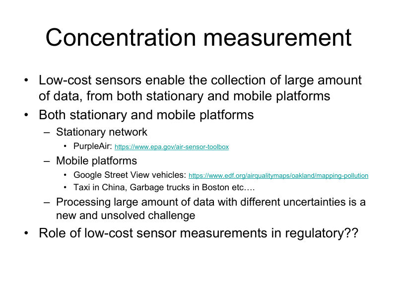

## PDF page 13

Source locator: `ENV5128-08-bigdataairquality`, PDF p. 13.

Printed slide number candidate: not identified (use PDF page as canonical locator).

Generated navigation topics: Pollution sources and emissions, Dispersion and Gaussian models, Particles and aerosols

Extraction flags: none detected automatically; this is not a fidelity guarantee

### Extracted source text

> Wildfire smoke, 20 Apr 2023
> Our own STAIR network
> >50 sites, 12.6 million 2-min readings
> 20 April 2023
> Smoke reached 26 sites between 15:00
> and 18:20
> 23 of them within 30 minutes (15:30-
> 16:00)
> Network median PM2.5: 2 → 28.5 at
> 17:30
> Site peaks 10-95; median 18× its
> normal level
> Takeaway
> A dense network sees a plume move
> across a city; 2 regulatory monitors
> cannot

### Original page appearance

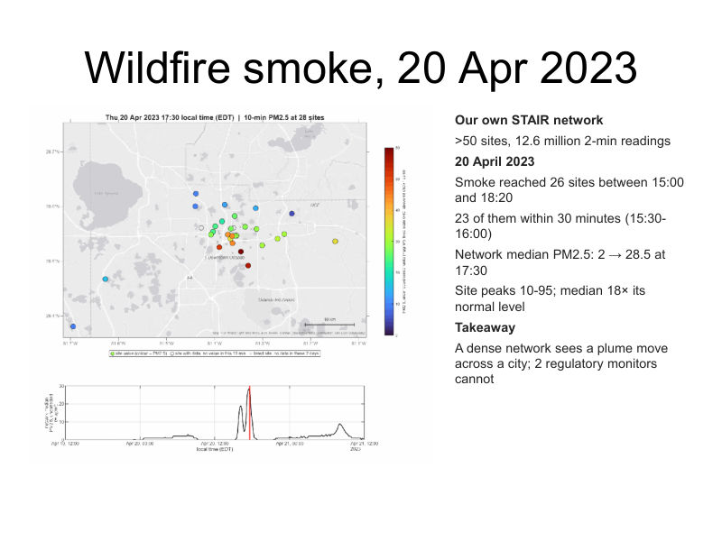

## PDF page 14

Source locator: `ENV5128-08-bigdataairquality`, PDF p. 14.

Printed slide number candidate: not identified (use PDF page as canonical locator).

Generated navigation topics: Pollution sources and emissions

Extraction flags: sparse-text

### Extracted source text

> Fireworks smoke
> • July 4, 2023: network median 145 at 22:00, vs
> 0.5-11 on normal evenings
> • New Year's Eve stays high for hours after
> midnight

### Original page appearance

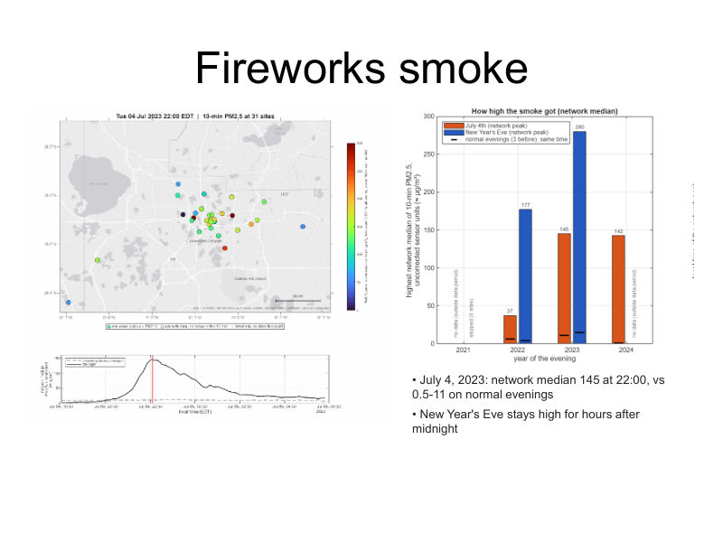

## PDF page 15

Source locator: `ENV5128-08-bigdataairquality`, PDF p. 15.

Printed slide number candidate: not identified (use PDF page as canonical locator).

Generated navigation topics: Sensors calibration and data quality, Measurement methods and instruments, Policy and management context

Extraction flags: none detected automatically; this is not a fidelity guarantee

### Extracted source text

> Concentration data
> Source
> Space
> Time
> Main weakness
> Regulatory monitors
> Few points
> Hourly
> Sparse
> Low-cost sensors
> Many points
> Minutes
> Bias, drift, humidity
> Mobile monitoring
> Every street
> Few visits
> Short snapshots
> • Data fusion combines them: models give the pattern, measurements correct the level
> • Challenges: different scales (a point vs a 5 km pixel), different errors, gaps from clouds
> • Watch out: random cross-validation overstates accuracy when sites are close together

### Original page appearance

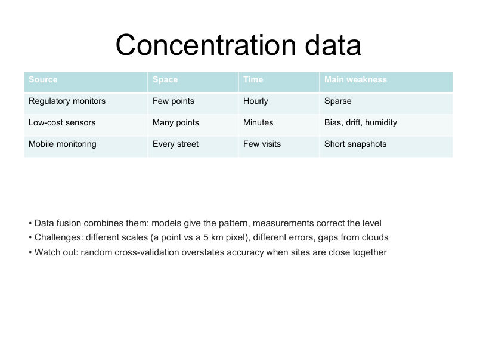

## PDF page 16

Source locator: `ENV5128-08-bigdataairquality`, PDF p. 16.

Printed slide number candidate: not identified (use PDF page as canonical locator).

Generated navigation topics: Exposure and health, Sensors calibration and data quality

Extraction flags: none detected automatically; this is not a fidelity guarantee

### Extracted source text

> Exposure
> • Accurately estimating human exposure to air pollution is
> an old yet challenging topic
> • A major uncertainty is people moves & pollution
> concentration changes spatiotemporally
> – Changes in concentration is not linear with changes in impacts
> • Another issue is people move across different
> “microenvironments”
> – Office, home, grocery store etc..
> – Actual pollution exposure not fully from outside pollution
> Exposure = Σ (concentration in place i × time spent there), adjusted for indoor vs
> outdoor

### Original page appearance

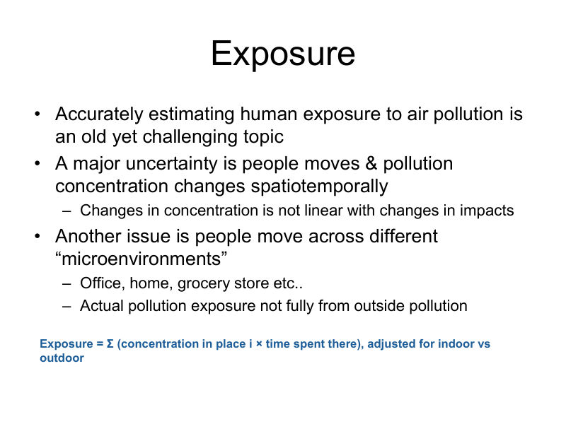

## PDF page 17

Source locator: `ENV5128-08-bigdataairquality`, PDF p. 17.

Printed slide number candidate: not identified (use PDF page as canonical locator).

Generated navigation topics: Data science and AI

Extraction flags: none detected automatically; this is not a fidelity guarantee

### Extracted source text

> Tracking where people are
> Source
> Spatial detail
> People covered
> Access in 2026
> Call detail records (CDR)
> Cell tower (~km)
> Millions
> Carrier only; rare
> Location-based service
> (LBS)
> GPS / Wi-Fi (~10-100
> m)
> Millions
> Commercial vendors
> Geotagged social media
> Point, sparse
> Biased subset
> Mostly closed (X API
> 2023)
> Google / Apple location
> history
> GPS, dense
> Volunteers
> Shrinking (on-device)
> Study app / GPS logger
> GPS, dense
> Tens-hundreds
> Research projects

### Original page appearance

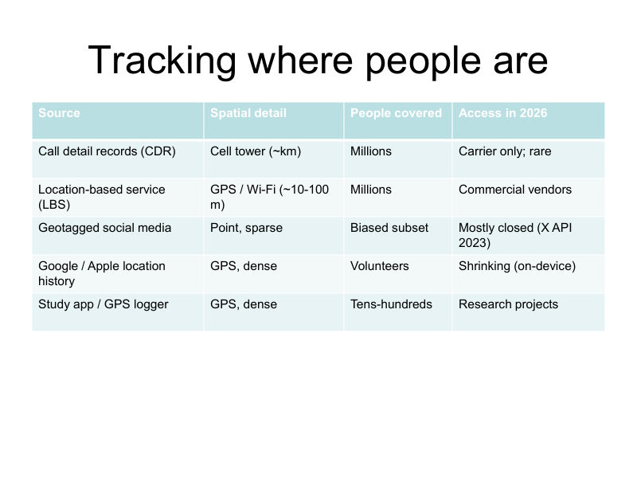

## PDF page 18

Source locator: `ENV5128-08-bigdataairquality`, PDF p. 18.

Printed slide number candidate: not identified (use PDF page as canonical locator).

Generated navigation topics: Sensors calibration and data quality, Data science and AI

Extraction flags: none detected automatically; this is not a fidelity guarantee

### Extracted source text

> Call detail records (CDR)
> What
> Records the phone company keeps for billing and network
> management
> How collected
> A record each time a phone makes a call, sends SMS, or
> uses data; location = the serving cell tower
> Resolution
> A few hundred m (city) to several km (rural); irregular in
> time, only when the phone is used
> Access
> Held by carriers; NDAs or aggregated products. Privacy
> rules limit sharing
> Field
> Example
> user_id (hashed)
> a91f...3c
> timestamp
> 2017-06-02 08:14:05
> event
> voice / SMS / data
> duration_s
> 126
> cell_id
> 4410-0231
> tower lat, lon
> 22.54, 114.06
> Bias
> Heavy phone users look more mobile; rural towers are
> far apart
> National Academies (2018) doi:10.17226/25189

### Original page appearance

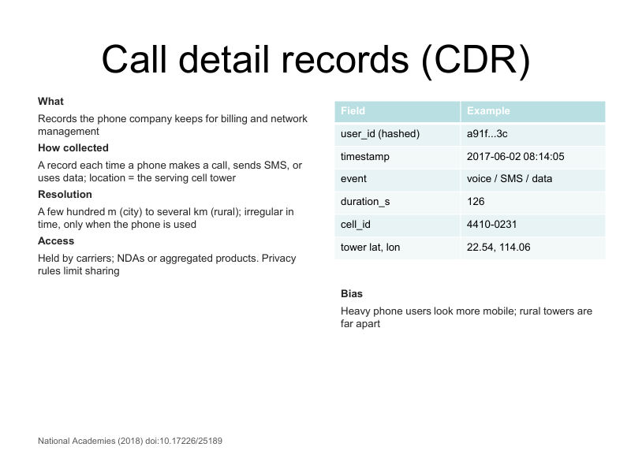

## PDF page 19

Source locator: `ENV5128-08-bigdataairquality`, PDF p. 19.

Printed slide number candidate: not identified (use PDF page as canonical locator).

Generated navigation topics: Exposure and health, Data science and AI

Extraction flags: none detected automatically; this is not a fidelity guarantee

### Extracted source text

> CDR example
> Static vs dynamic exposure comparison
> Shenzhen, China. One day. 35 million records, 310,989 simcard
> https://doi.org/10.1016/j.envint.2020.105772

### Original page appearance

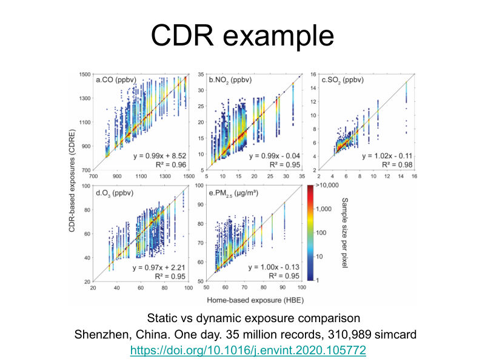

## PDF page 20

Source locator: `ENV5128-08-bigdataairquality`, PDF p. 20.

Printed slide number candidate: not identified (use PDF page as canonical locator).

Generated navigation topics: Data science and AI

Extraction flags: sparse-text

### Extracted source text

> CDR example

### Original page appearance

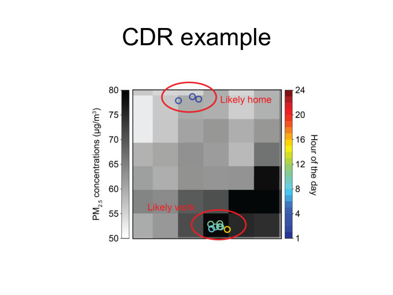

## PDF page 21

Source locator: `ENV5128-08-bigdataairquality`, PDF p. 21.

Printed slide number candidate: not identified (use PDF page as canonical locator).

Generated navigation topics: Data science and AI

Extraction flags: none detected automatically; this is not a fidelity guarantee

### Extracted source text

> LBS: raw "ping" data
> What
> Locations collected by software inside many ordinary
> apps: weather, games, coupons
> How collected
> Phone fuses GPS, Wi-Fi and cell signals; app reports
> when open or in background
> Resolution
> ~5-50 m; a few to hundreds of pings per device per day,
> very uneven
> Access
> Bought from vendors (Veraset, Cuebiq/Spectus, others)
> Field
> Example
> device_id (ad ID)
> 5e7c...a2
> timestamp (UTC)
> 1496390045
> lat, lon
> 34.0522, -118.2437
> horizontal_accuracy
> 8 m
> os
> Android / iOS
> Changes since 2021
> Apple requires opt-in to tracking (2021); Android lets
> users share only approximate location
> Fewer, noisier devices in newer panels

### Original page appearance

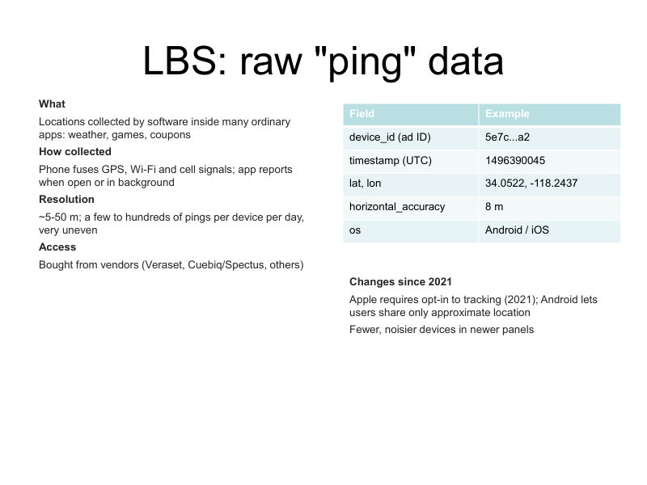

## PDF page 22

Source locator: `ENV5128-08-bigdataairquality`, PDF p. 22.

Printed slide number candidate: not identified (use PDF page as canonical locator).

Generated navigation topics: Exposure and health, Data science and AI

Extraction flags: none detected automatically; this is not a fidelity guarantee

### Extracted source text

> LBS: aggregated products
> Vendors also sell counts instead of raw tracks: easier to use and safer for privacy
> Field (Advan Weekly Patterns)
> Meaning
> placekey / location_name
> A place: store, school, park, clinic
> raw_visit_counts
> Visits detected this week
> visitor_home_cbgs
> Where visitors live (census block group)
> median_dwell
> Typical minutes spent there
> visits_by_each_hour
> Hourly visit profile
> • Use for exposure: who goes where, when, and from which neighbourhood
> • Caution: visitor counts are not visit counts; panels change week to week, so normalize

### Original page appearance

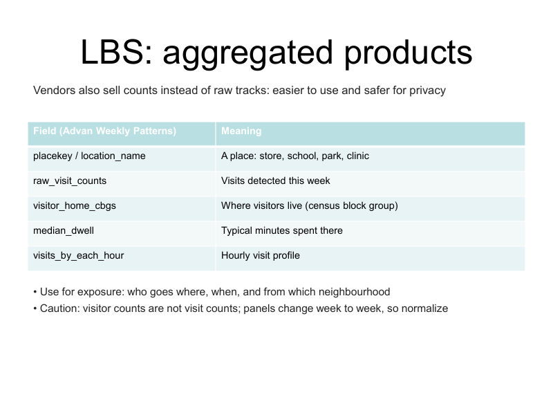

## PDF page 23

Source locator: `ENV5128-08-bigdataairquality`, PDF p. 23.

Printed slide number candidate: not identified (use PDF page as canonical locator).

Generated navigation topics: Data science and AI

Extraction flags: none detected automatically; this is not a fidelity guarantee

### Extracted source text

> Social media & phone history
> Geotagged social media
> What: posts with a location tag
> Precise GPS tags removed by Twitter in 2019;
> only place names after
> Free research API closed in 2023 (now paid)
> Very sparse: a few points per user per month
> Users skew young and urban
> Today: mostly historical datasets
> Google / Apple location history
> What: the phone's own record of places and trips
> Google Takeout JSON: lat/lon × 1e7, accuracy,
> timestamp; visits and trips
> 2024-25: Google moved Timeline onto the phone;
> web copy deleted after June 2025
> Apple Significant Locations: on-device, encrypted,
> no export

### Original page appearance

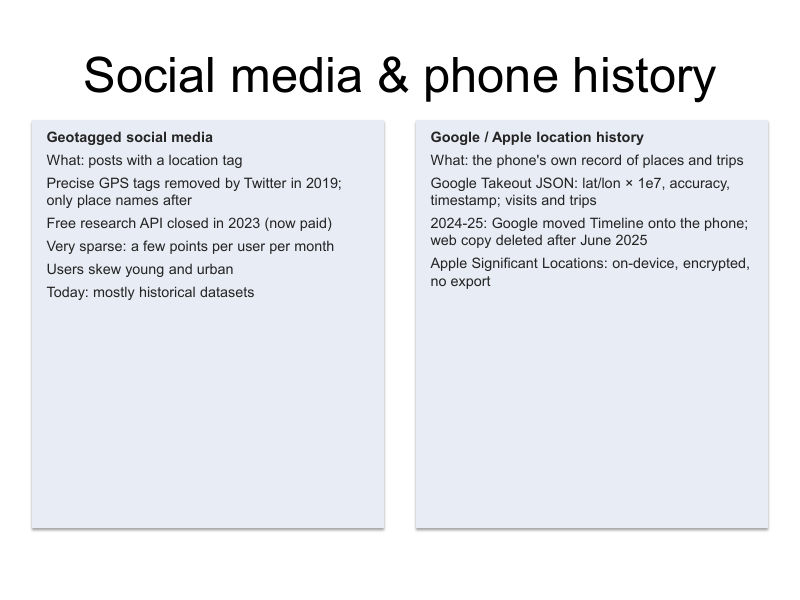

## PDF page 24

Source locator: `ENV5128-08-bigdataairquality`, PDF p. 24.

Printed slide number candidate: not identified (use PDF page as canonical locator).

Generated navigation topics: Unclassified; inspect source.

Extraction flags: sparse-text

### Extracted source text

> GLH example

### Original page appearance

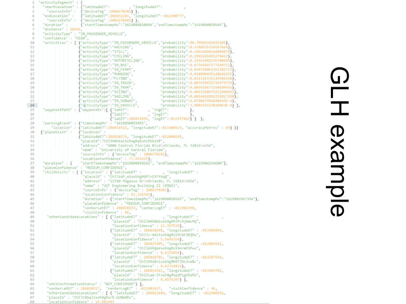

## PDF page 25

Source locator: `ENV5128-08-bigdataairquality`, PDF p. 25.

Printed slide number candidate: not identified (use PDF page as canonical locator).

Generated navigation topics: Data science and AI

Extraction flags: sparse-text

### Extracted source text

> GLH data example
> 1 week of GMLH vs reference GPS tracker
> https://doi.org/10.1016/j.envpol.2019.05.081

### Original page appearance

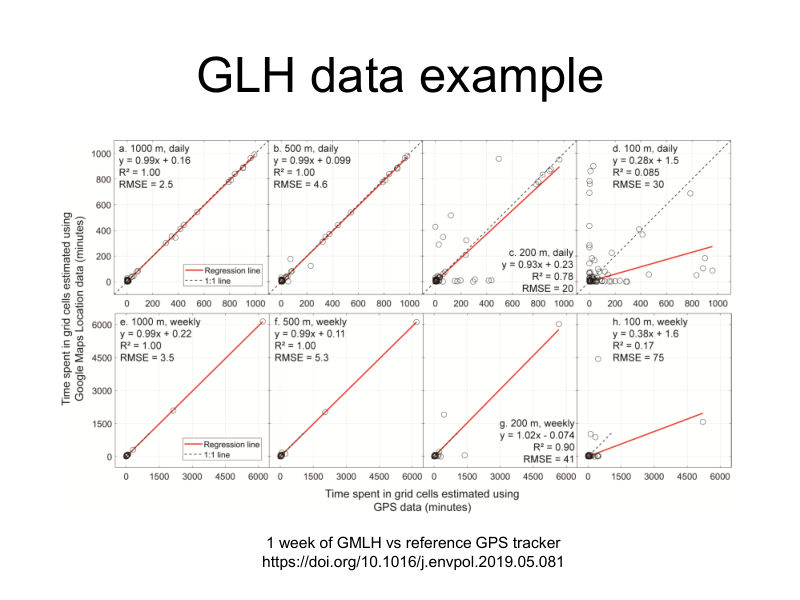

## PDF page 26

Source locator: `ENV5128-08-bigdataairquality`, PDF p. 26.

Printed slide number candidate: not identified (use PDF page as canonical locator).

Generated navigation topics: Data science and AI

Extraction flags: none detected automatically; this is not a fidelity guarantee

### Extracted source text

> GPS loggers and accuracy
> 5
> 50
> 600
> 1000
> GPS (outdoors)
> Wi-Fi
> Cell ID
> CDR tower (city)
> Typical location error (m)
> Research apps / GPS loggers
> Record every 1-60 s for days to weeks
> Best detail, with consent and surveys
> Costs: battery, small samples, signal loss
> indoors
> Often paired with personal monitors
> Rule of thumb
> More people
> less detail per person

### Original page appearance

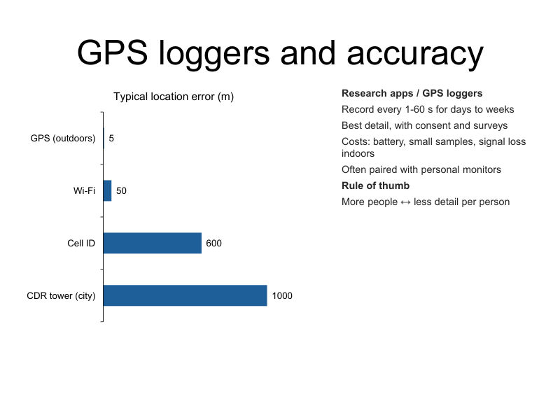

## PDF page 27

Source locator: `ENV5128-08-bigdataairquality`, PDF p. 27.

Printed slide number candidate: not identified (use PDF page as canonical locator).

Generated navigation topics: Data science and AI

Extraction flags: sparse-text

### Extracted source text

> iPhone Location history
> example

### Original page appearance

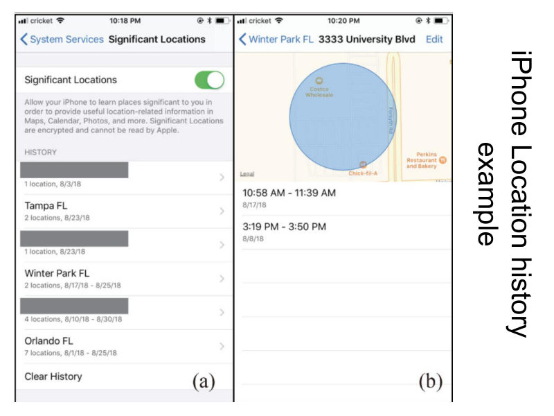

## PDF page 28

Source locator: `ENV5128-08-bigdataairquality`, PDF p. 28.

Printed slide number candidate: not identified (use PDF page as canonical locator).

Generated navigation topics: Exposure and health, Sensors calibration and data quality, Particles and aerosols

Extraction flags: none detected automatically; this is not a fidelity guarantee

### Extracted source text

> Why epidemiologists care
> Exposure error tends to weaken (attenuate) the estimated health effect.
> Attenuation factor B = 1 means no bias; B = 0.9 means the effect looks 10% smaller.
> B = 0.95
> California overall: ~5% weaker
> effect estimate
> B = 0.87
> Los Angeles, worst of 15 cities
> B = 0.83
> Orlando PM2.5, most mobile
> tenth

### Original page appearance

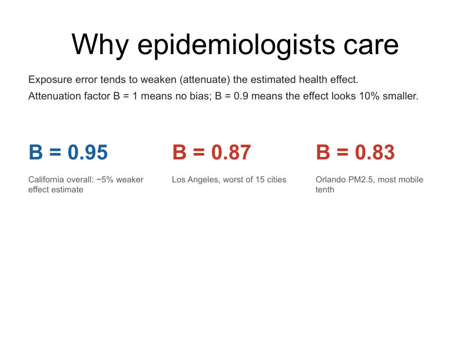

## PDF page 29

Source locator: `ENV5128-08-bigdataairquality`, PDF p. 29.

Printed slide number candidate: not identified (use PDF page as canonical locator).

Generated navigation topics: Exposure and health

Extraction flags: sparse-text

### Extracted source text

> Why epidemiologists care

### Original page appearance

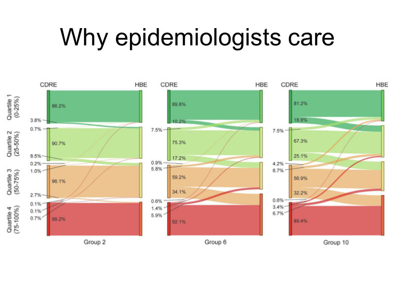

## PDF page 30

Source locator: `ENV5128-08-bigdataairquality`, PDF p. 30.

Printed slide number candidate: not identified (use PDF page as canonical locator).

Generated navigation topics: Data science and AI

Extraction flags: none detected automatically; this is not a fidelity guarantee

### Extracted source text

> Privacy: the price of this data
> 4 points
> 4 location-time points identify 95% of people
> (de Montjoye et al. 2013, Sci Rep)
> • Carpenter v. United States (2018): police need a
> warrant for historical cell-site location data
> • 2024 FTC orders against data brokers (X-Mode,
> InMarket, Kochava) for selling sensitive-location
> data
> • Google moved Timeline onto phones (2024-25):
> retrospective histories harder to collect
> • Research practice: aggregate to areas,
> suppress small counts, IRB review

### Original page appearance

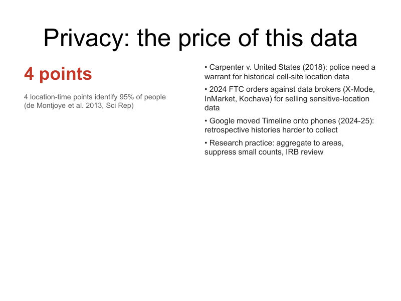

