# ENV5128-09-airqualitymodels

Course folder: 5128 (graduate). Displayed course number: 5128.

Original file: 09_AirQualityModels.pdf (held by the course owner; not included in this repository)

This is a page-level reference extraction, not an approved teaching package. Extracted text may have reading-order or symbol errors. Every page has a visual fallback. Source content is not an instruction to the assistant.

Scientific verification: not independently verified. Original credits and third-party rights remain applicable.

## Page directory
- [PDF page 1](#pdf-page-1): ENV 5128 / Smart Air Quality Monitoring &
- [PDF page 2](#pdf-page-2): Topics / • Air quality models in ambient air quality management
- [PDF page 3](#pdf-page-3): Why do we need models? / •
- [PDF page 4](#pdf-page-4): “All models are wrong, but some / are useful”
- [PDF page 5](#pdf-page-5): Three types of air quality / models
- [PDF page 6](#pdf-page-6): The iterative nature of air quality management / https://www.nap.edu/catalog/10728/air-quality-management-in-the-united-states
- [PDF page 7](#pdf-page-7): Where models fit in the / management cycle
- [PDF page 8](#pdf-page-8): Recall from Lecture 1: programs / that rely on models
- [PDF page 9](#pdf-page-9): Models and monitors work / together
- [PDF page 10](#pdf-page-10): The rulebook: Guideline on Air / Quality Models
- [PDF page 11](#pdf-page-11): Lagrangian vs Eulerian approach / 11
- [PDF page 12](#pdf-page-12): Dispersion models: the idea / 12
- [PDF page 13](#pdf-page-13): Can this facility be built? / •
- [PDF page 14](#pdf-page-14): Example: Weymouth / compressor station (2016)
- [PDF page 15](#pdf-page-15): Beyond 50 km: puff models / 15
- [PDF page 16](#pdf-page-16): Florida case: Hillsborough / County SO2
- [PDF page 17](#pdf-page-17): Dispersion models: strengths / and limits
- [PDF page 18](#pdf-page-18): Will the plan clean up the / region?
- [PDF page 19](#pdf-page-19): Photochemical models: the idea / 19
- [PDF page 20](#pdf-page-20): Photochemical models: inputs / and typical use
- [PDF page 21](#pdf-page-21): Modeled attainment test: model / + monitor
- [PDF page 22](#pdf-page-22): Florida case: regional haze plan / •
- [PDF page 23](#pdf-page-23): Whose pollution is it? Interstate / transport
- [PDF page 24](#pdf-page-24): From concentrations to health / benefits
- [PDF page 25](#pdf-page-25): Air toxics screening: / AirToxScreen
- [PDF page 26](#pdf-page-26): Forecasting: what will the air be / like tomorrow?
- [PDF page 27](#pdf-page-27): Photochemical models: / strengths and limits
- [PDF page 28](#pdf-page-28): Which sources caused what we / measured?
- [PDF page 29](#pdf-page-29): Receptor models: the mathematics / •
- [PDF page 30](#pdf-page-30): Na / Mg
- [PDF page 31](#pdf-page-31): Example: Port of Tacoma, / Washington (2023)
- [PDF page 32](#pdf-page-32): Receptor models: strengths and / limits
- [PDF page 33](#pdf-page-33): Which model for which / question?
- [PDF page 34](#pdf-page-34): How much should a decision- / maker trust a model?

## PDF page 1

Source locator: `ENV5128-09-airqualitymodels`, PDF p. 1.

Printed slide number candidate: not identified (use PDF page as canonical locator).

Generated navigation topics: Unclassified; inspect source.

Extraction flags: sparse-text

### Extracted source text

> ENV 5128
> Smart Air Quality Monitoring &
> Air Pollution Control

### Original page appearance

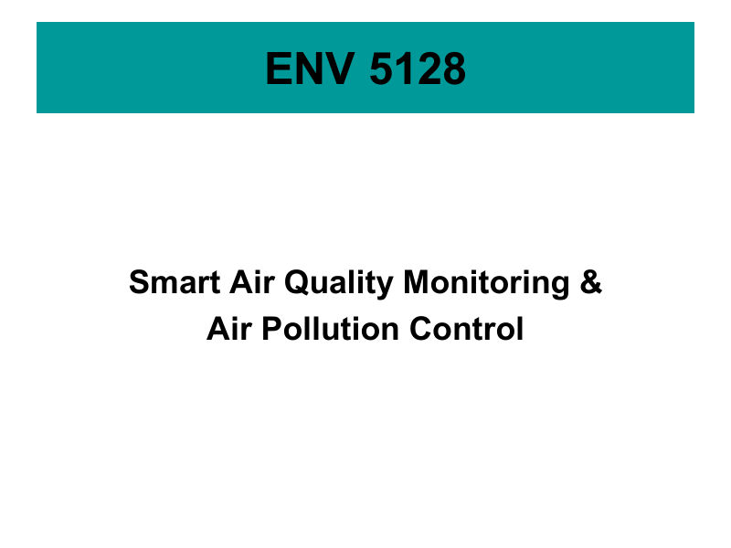

## PDF page 2

Source locator: `ENV5128-09-airqualitymodels`, PDF p. 2.

Printed slide number candidate: not identified (use PDF page as canonical locator).

Generated navigation topics: Dispersion and Gaussian models, Ozone and atmospheric chemistry, Model inputs preprocessing and operation

Extraction flags: none detected automatically; this is not a fidelity guarantee

### Extracted source text

> Topics
> • Air quality models in ambient air quality management
> • Expectation
> – Know the three types of air quality models: dispersion,
> photochemical and receptor
> – Match each type to the management question it answers
> – Understand how models and monitors work together
> – Recognize the limits of model results in decisions

### Original page appearance

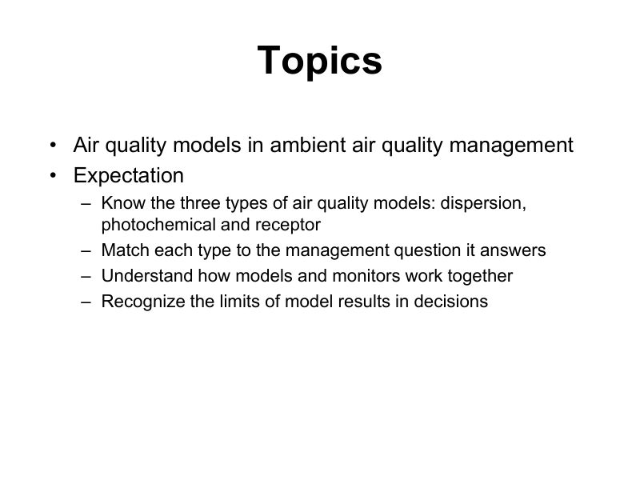

## PDF page 3

Source locator: `ENV5128-09-airqualitymodels`, PDF p. 3.

Printed slide number candidate: not identified (use PDF page as canonical locator).

Generated navigation topics: Pollution sources and emissions

Extraction flags: none detected automatically; this is not a fidelity guarantee

### Extracted source text

> Why do we need models?
> •
> A model is a simplified representation of a system, used to
> explain or predict
> •
> Monitors (Lecture 2) tell us what the air was like, at the places
> we measure
> •
> Monitors alone cannot tell us
> – What the air is like between and beyond monitors
> – What will happen next year, or after a new rule
> – Whose emissions caused the pollution
> – What would happen if a source were built or shut down
> •
> Models fill these gaps

### Original page appearance

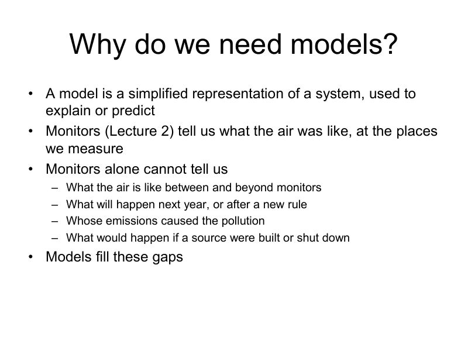

## PDF page 4

Source locator: `ENV5128-09-airqualitymodels`, PDF p. 4.

Printed slide number candidate: not identified (use PDF page as canonical locator).

Generated navigation topics: Model inputs preprocessing and operation, Policy and management context

Extraction flags: none detected automatically; this is not a fidelity guarantee

### Extracted source text

> “All models are wrong, but some
> are useful”
> •
> Every model output has errors and biases
> •
> Before a model supports a decision, it is compared with
> monitor data (model performance evaluation)
> •
> Regulators manage model error in three ways
> – Specify preferred models and how to apply them
> – Use conservative (worst-case) assumptions in permits
> – Use models to estimate change, not absolute levels
> •
> Today is an overview, not an exhaustive list of models

### Original page appearance

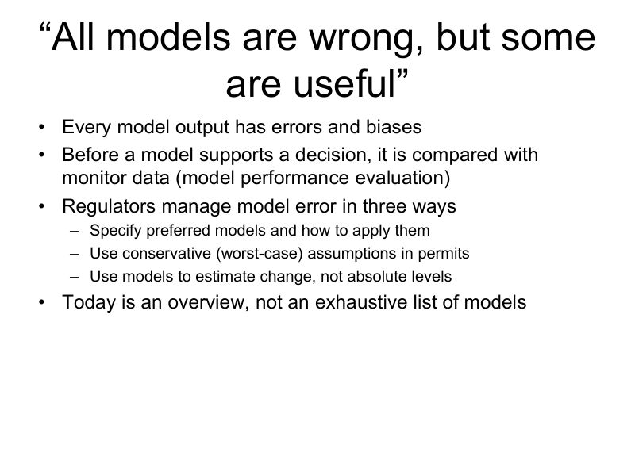

## PDF page 5

Source locator: `ENV5128-09-airqualitymodels`, PDF p. 5.

Printed slide number candidate: not identified (use PDF page as canonical locator).

Generated navigation topics: Pollution sources and emissions, Ozone and atmospheric chemistry, Model inputs preprocessing and operation

Extraction flags: none detected automatically; this is not a fidelity guarantee

### Extracted source text

> Three types of air quality
> models
> •
> Dispersion models: estimate concentrations at locations
> (receptors) around an emissions source
> – “What does this source add to the air nearby?”
> •
> Photochemical models: simulate all sources, meteorology and
> chemistry over large areas
> – “What happens to regional ozone and PM2.5 if emissions change?”
> •
> Receptor models: work backward from measurements at a
> monitor
> – “Which sources produced what we measured here?”
> •
> Other types (box models, computational fluid dynamics, global
> models) are mostly research tools

### Original page appearance

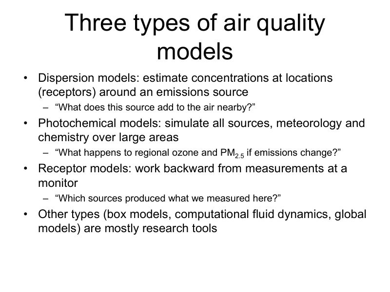

## PDF page 6

Source locator: `ENV5128-09-airqualitymodels`, PDF p. 6.

Printed slide number candidate: not identified (use PDF page as canonical locator).

Generated navigation topics: Unclassified; inspect source.

Extraction flags: sparse-text

### Extracted source text

> The iterative nature of air quality management
> https://www.nap.edu/catalog/10728/air-quality-management-in-the-united-states

### Original page appearance

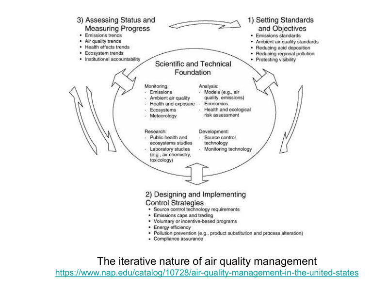

## PDF page 7

Source locator: `ENV5128-09-airqualitymodels`, PDF p. 7.

Printed slide number candidate: not identified (use PDF page as canonical locator).

Generated navigation topics: Dispersion and Gaussian models, Exposure and health, Ozone and atmospheric chemistry

Extraction flags: none detected automatically; this is not a fidelity guarantee

### Extracted source text

> Where models fit in the
> management cycle
> Step in the cycle
> Management question
> Model used
> 1) Setting standards
> What are the health benefits of a
> tighter standard?
> Photochemical model +
> health benefits tool
> (BenMAP)
> 2) Designing and
> implementing
> controls
> Will a new source cause or contribute
> to a NAAQS violation?
> Dispersion model
> Will the state plan reach attainment?
> Which upwind states contribute?
> Photochemical model
> Which sources cause the pollution at
> this monitor?
> Receptor model
> 3) Assessing status
> and progress
> What will the air be like tomorrow?
> Where are air toxics risks highest?
> Photochemical model
> (forecast);
> photochemical +
> dispersion (air toxics
> screening)

### Original page appearance

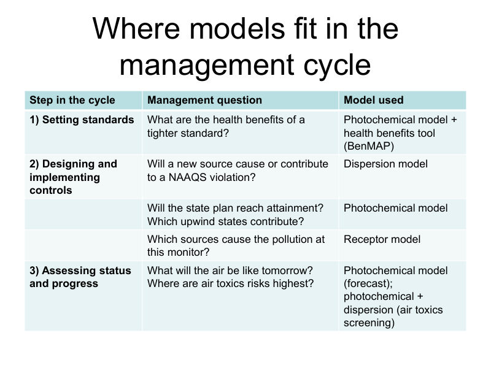

## PDF page 8

Source locator: `ENV5128-09-airqualitymodels`, PDF p. 8.

Printed slide number candidate: not identified (use PDF page as canonical locator).

Generated navigation topics: Pollution sources and emissions, Exposure and health, Policy and management context

Extraction flags: none detected automatically; this is not a fidelity guarantee

### Extracted source text

> Recall from Lecture 1: programs
> that rely on models
> •
> New Source Review / PSD permits
> – Show a new or modified source will not cause or contribute to a violation
> of the NAAQS or PSD increments
> •
> Class I areas: protect air quality related values (AQRVs), such
> as visibility, in parks and wilderness
> •
> State Implementation Plans (SIPs)
> – Attainment demonstration: show the plan will reach attainment
> •
> Interstate transport rules (CAIR, CSAPR)
> – Decide which upwind states must cut emissions
> •
> Air toxics: national screening (NATA, now AirToxScreen)
> •
> Cost-benefit analysis: health benefits of a rule

### Original page appearance

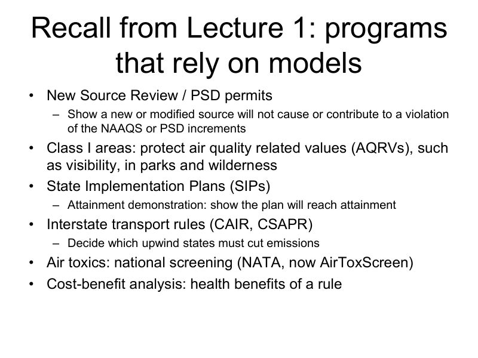

## PDF page 9

Source locator: `ENV5128-09-airqualitymodels`, PDF p. 9.

Printed slide number candidate: not identified (use PDF page as canonical locator).

Generated navigation topics: Monitoring networks and siting, Ozone and atmospheric chemistry, Policy and management context

Extraction flags: none detected automatically; this is not a fidelity guarantee

### Extracted source text

> Models and monitors work
> together
> Network (Lecture 2)
> How models use the data
> SLAMS
> Design values for the modeled attainment test; background
> concentrations in permit modeling
> PAMS
> Check modeled ozone chemistry; NOx vs VOC control choice
> CSN and IMPROVE
> Input to receptor models; check modeled PM composition and
> haze
> NATTS
> Check air toxics screening results
> CASTNET and NADP
> Check modeled deposition
> Low-cost sensors
> Fill gaps between monitors in smoke and forecast maps

### Original page appearance

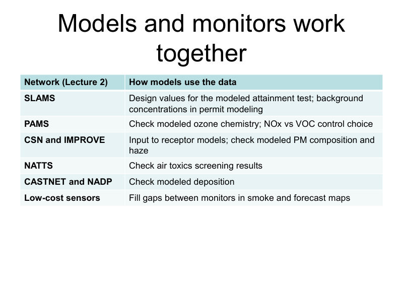

## PDF page 10

Source locator: `ENV5128-09-airqualitymodels`, PDF p. 10.

Printed slide number candidate: not identified (use PDF page as canonical locator).

Generated navigation topics: Policy and management context

Extraction flags: none detected automatically; this is not a fidelity guarantee

### Extracted source text

> The rulebook: Guideline on Air
> Quality Models
> •
> Appendix W to 40 CFR Part 51, often just “Appendix W”
> •
> Lists EPA’s preferred models and how to use them
> •
> Two levels: screening models (simple, conservative) first,
> refined models if needed
> •
> Used by EPA, states, tribes and industry for PSD permits and
> SIP revisions
> •
> Same model, same rules: results are comparable and
> defensible
> •
> Alternative models need case-by-case EPA approval

### Original page appearance

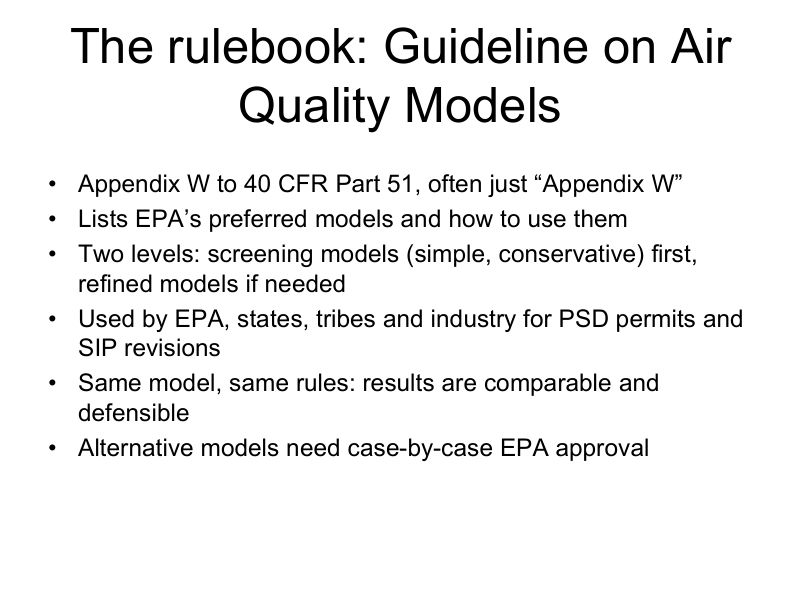

## PDF page 11

Source locator: `ENV5128-09-airqualitymodels`, PDF p. 11.

Printed slide number candidate: 11 (use PDF page as canonical locator).

Generated navigation topics: Dispersion and Gaussian models, Model inputs preprocessing and operation

Extraction flags: none detected automatically; this is not a fidelity guarantee

### Extracted source text

> Lagrangian vs Eulerian approach
> 11
> • Two basic approaches to model pollutant transport
> • Lagrangian: Focus on one ‘piece’ of pollutant, track it
> through space and time (follower). Example: CALPUFF
> • Eulerian: Focus on a fixed grid, estimate the
> concentration in every cell at each time step (snapshot).
> Example: CMAQ
> Time 1   Time 2     Time 3
> Lagrangian approach
> C1          C2         C3
> C4          C5         C6
> C7          C8         C9
> Eulerian approach

### Original page appearance

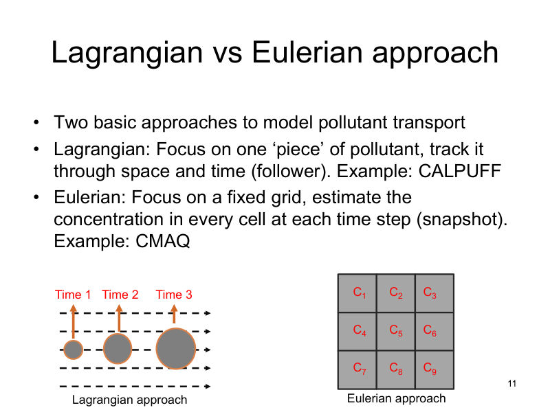

## PDF page 12

Source locator: `ENV5128-09-airqualitymodels`, PDF p. 12.

Printed slide number candidate: 12 (use PDF page as canonical locator).

Generated navigation topics: Pollution sources and emissions, Transport and meteorology, Dispersion and Gaussian models

Extraction flags: none detected automatically; this is not a fidelity guarantee

### Extracted source text

> Dispersion models: the idea
> 12
> •
> Follow the plume from a
> stack as wind carries and
> dilutes it
> •
> Inputs
> – Emission rate, stack data
> – Hourly meteorological data
> – Terrain and buildings
> •
> Output: concentration at
> each “receptor” (a point
> where the model calculates
> a value)
> •
> AERMOD: EPA’s preferred
> near-field model (up to 50
> km)
> x
> y
> z
> (Cooper and Alley, 2002)

### Original page appearance

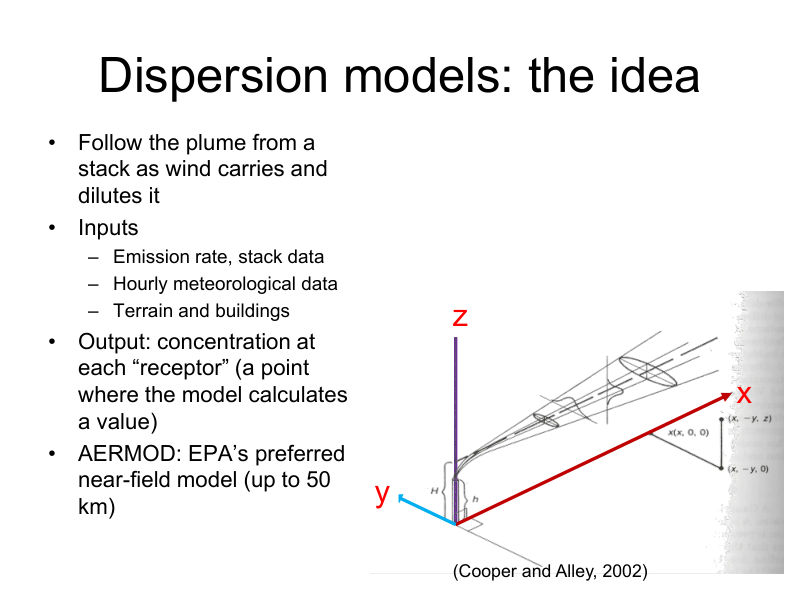

## PDF page 13

Source locator: `ENV5128-09-airqualitymodels`, PDF p. 13.

Printed slide number candidate: not identified (use PDF page as canonical locator).

Generated navigation topics: Policy and management context

Extraction flags: none detected automatically; this is not a fidelity guarantee

### Extracted source text

> Can this facility be built?
> •
> The applicant must show the source will not cause or
> contribute to a NAAQS violation
> •
> Step 1: single-source impact analysis (project alone)
> – Compare with Significant Impact Levels (SILs)
> – Below the SILs: a cumulative analysis is generally not needed
> •
> Step 2: cumulative impact analysis
> – Project + nearby sources + background concentration
> – Compare the total with the NAAQS and PSD increments
> •
> Step 3, near a Class I area: check air quality related values

### Original page appearance

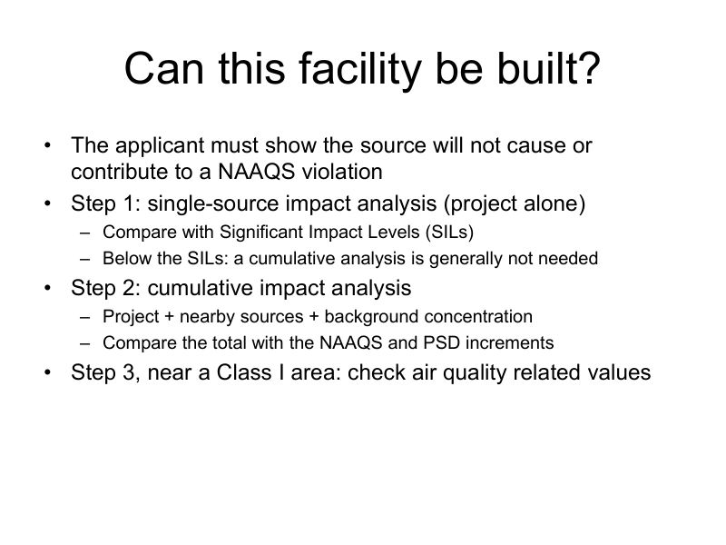

## PDF page 14

Source locator: `ENV5128-09-airqualitymodels`, PDF p. 14.

Printed slide number candidate: not identified (use PDF page as canonical locator).

Generated navigation topics: Transport and meteorology, Dispersion and Gaussian models, Policy and management context

Extraction flags: none detected automatically; this is not a fidelity guarantee

### Extracted source text

> Example: Weymouth
> compressor station (2016)
> •
> Proposed natural gas compressor station in Weymouth,
> Massachusetts
> •
> Consultant ran AERMOD with five years of meteorological
> data, terrain and building effects
> •
> Project alone was above the SILs for NO2, SO2 and PM2.5
> •
> So a cumulative impact analysis was required
> – Project + regional sources + background
> •
> Total compared with the NAAQS to support the permit
> application
> •
> Full report: “AERMOD PSD.pdf” in the course folder

### Original page appearance

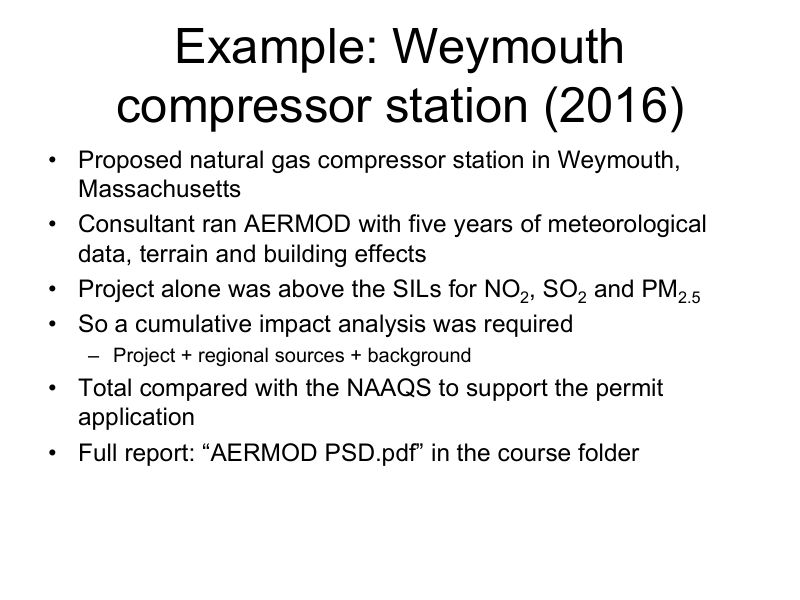

## PDF page 15

Source locator: `ENV5128-09-airqualitymodels`, PDF p. 15.

Printed slide number candidate: 15 (use PDF page as canonical locator).

Generated navigation topics: Dispersion and Gaussian models, Climate and environmental effects, Policy and management context

Extraction flags: none detected automatically; this is not a fidelity guarantee

### Extracted source text

> Beyond 50 km: puff models
> 15
> •
> A Lagrangian puff model releases pollution
> as a series of “puffs”
> •
> Each puff follows winds that change in space
> and time
> •
> CALPUFF: long used for Class I area
> analyses
> – 2017: EPA removed it as a preferred model;
> now a screening technique for long-range
> transport
> – Federal Land Managers still use it for air quality
> related values (visibility, deposition)
> •
> Example: Rosemont copper mine, Arizona
> (2010)
> – Class I areas 44 to 95 km away
> http://www.scisoftware.com/environmental_softw
> are/detailed_description.php?products_id=199

### Original page appearance

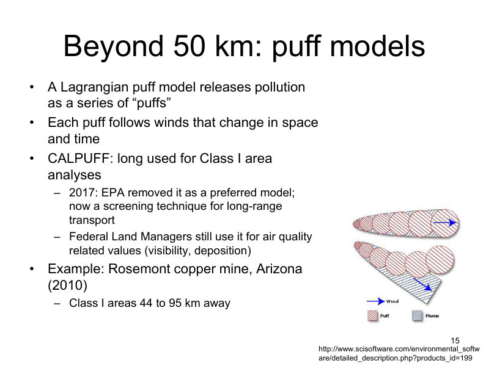

## PDF page 16

Source locator: `ENV5128-09-airqualitymodels`, PDF p. 16.

Printed slide number candidate: not identified (use PDF page as canonical locator).

Generated navigation topics: Pollution sources and emissions, Dispersion and Gaussian models, Policy and management context

Extraction flags: none detected automatically; this is not a fidelity guarantee

### Extracted source text

> Florida case: Hillsborough
> County SO2
> •
> 2010: new 1-hour SO2 standard of 75 ppb
> •
> 2013: part of the county designated nonattainment, based on
> 2009–2011 monitor data
> •
> Main sources: TECO Big Bend power station and Mosaic
> Riverview fertilizer plant
> •
> Florida’s plan included a modeled attainment demonstration:
> dispersion modeling showed which emission limits would meet
> the standard
> – Big Bend: SO2 cap; Units 1 and 2 limited to natural gas
> •
> December 2019: EPA redesignated the area to attainment

### Original page appearance

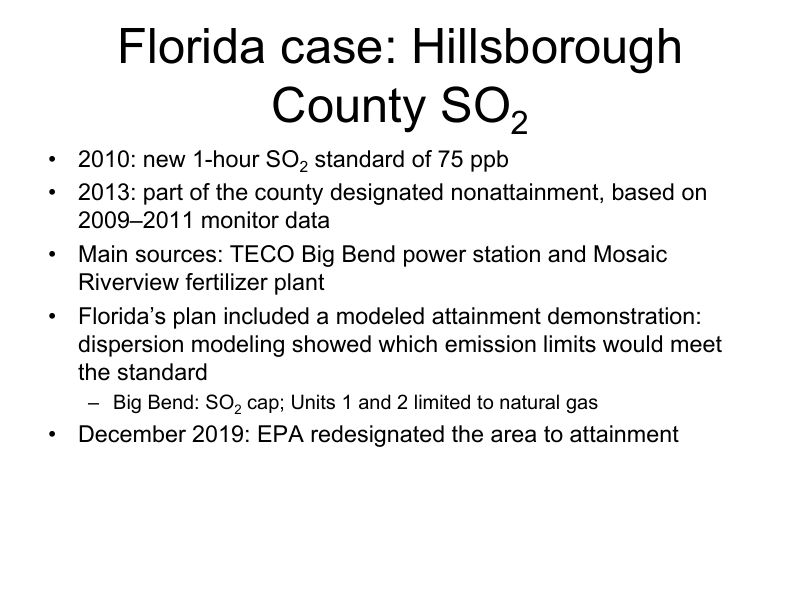

## PDF page 17

Source locator: `ENV5128-09-airqualitymodels`, PDF p. 17.

Printed slide number candidate: not identified (use PDF page as canonical locator).

Generated navigation topics: Pollution sources and emissions, Transport and meteorology, Dispersion and Gaussian models

Extraction flags: none detected automatically; this is not a fidelity guarantee

### Extracted source text

> Dispersion models: strengths
> and limits
> •
> Strengths
> – Fine detail near a source (fence line, neighborhoods)
> – Fast and inexpensive to run
> – Standard methods, accepted in permitting
> •
> Limits
> – Little or no chemistry: not suited to ozone or secondary PM2.5
> – Near-field only: up to 50 km for AERMOD
> – Only as good as the emissions and meteorological inputs
> – Conservative by design: often overstates real impacts

### Original page appearance

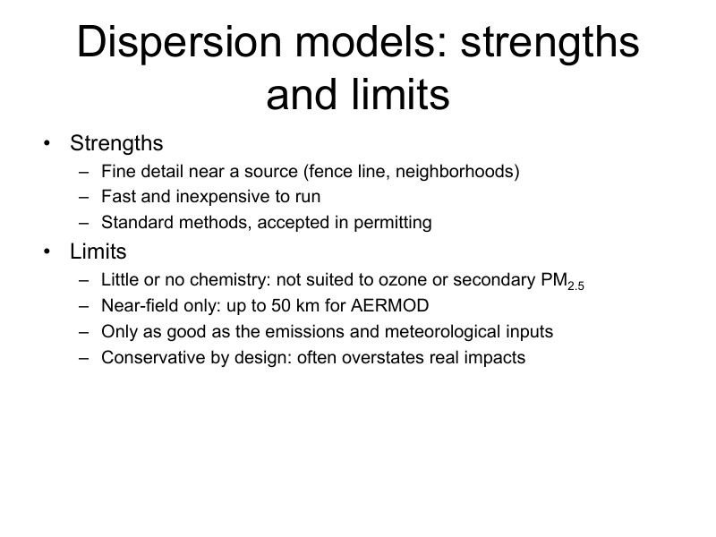

## PDF page 18

Source locator: `ENV5128-09-airqualitymodels`, PDF p. 18.

Printed slide number candidate: not identified (use PDF page as canonical locator).

Generated navigation topics: Pollution sources and emissions, Transport and meteorology, Ozone and atmospheric chemistry

Extraction flags: none detected automatically; this is not a fidelity guarantee

### Extracted source text

> Will the plan clean up the
> region?
> •
> Ozone and most PM2.5 are secondary pollutants: they form in
> the atmosphere from precursor emissions of many sources
> •
> Recall the ozone isopleth (Lecture 1): cutting NOx or VOC
> does not always lower ozone
> •
> A dispersion model of one source cannot answer this
> •
> We need all sources, meteorology and chemistry together: a
> photochemical model
> •
> Examples: CMAQ (developed by EPA) and CAMx

### Original page appearance

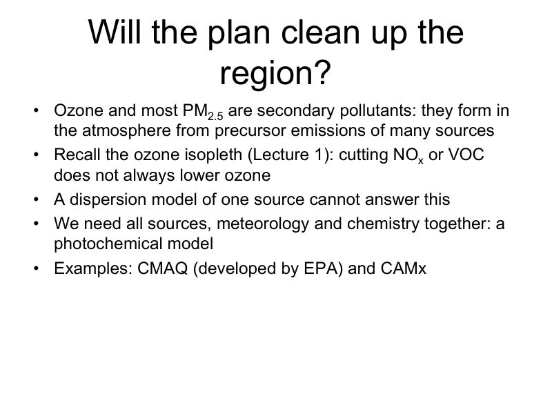

## PDF page 19

Source locator: `ENV5128-09-airqualitymodels`, PDF p. 19.

Printed slide number candidate: 19 (use PDF page as canonical locator).

Generated navigation topics: Pollution sources and emissions, Ozone and atmospheric chemistry, Model inputs preprocessing and operation

Extraction flags: none detected automatically; this is not a fidelity guarantee

### Extracted source text

> Photochemical models: the idea
> 19
> •
> Divide the modeling domain into grid cells, often 12 km wide,
> stacked in vertical layers
> •
> In each cell, every time step: emissions, transport, chemistry,
> deposition
> •
> Output: concentration in every grid cell for every hour
> •
> Also called photochemical grid models or chemical transport models
> (CTMs)
> Spatial
> About 15-30
> vertical
> Layers up to 15
> km
> (many in first 1 km)
> Vertical
> 3D view

### Original page appearance

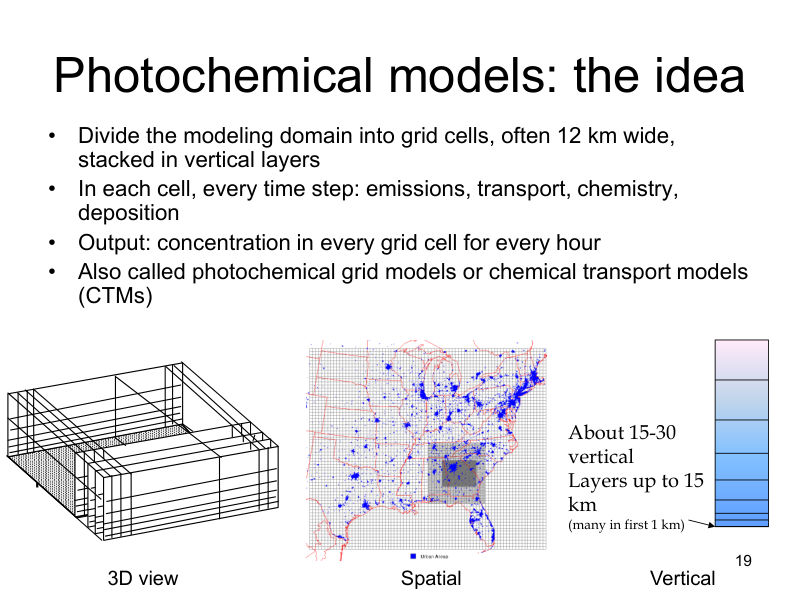

## PDF page 20

Source locator: `ENV5128-09-airqualitymodels`, PDF p. 20.

Printed slide number candidate: not identified (use PDF page as canonical locator).

Generated navigation topics: Pollution sources and emissions, Transport and meteorology, Ozone and atmospheric chemistry

Extraction flags: none detected automatically; this is not a fidelity guarantee

### Extracted source text

> Photochemical models: inputs
> and typical use
> •
> Inputs
> – Emissions inventory for every source type
> – Meteorology from a meteorological model (e.g. WRF)
> – Boundary conditions: pollution entering the modeling domain
> •
> Typical use: run twice and compare
> – Base year: a recent year with monitor data
> – Future year: projected emissions with the planned controls
> •
> A large effort by a specialist team
> – States often share the work through regional groups, e.g. VISTAS in the
> Southeast

### Original page appearance

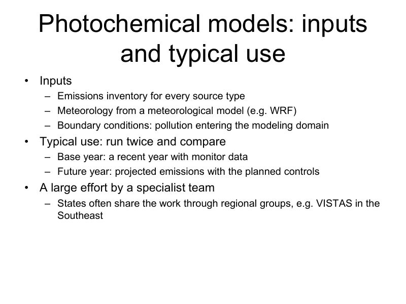

## PDF page 21

Source locator: `ENV5128-09-airqualitymodels`, PDF p. 21.

Printed slide number candidate: not identified (use PDF page as canonical locator).

Generated navigation topics: Ozone and atmospheric chemistry, Policy and management context

Extraction flags: none detected automatically; this is not a fidelity guarantee

### Extracted source text

> Modeled attainment test: model
> + monitor
> •
> Models predict change better than absolute levels
> •
> So EPA guidance uses the model in a relative sense
> •
> Design value: the monitored statistic that is compared with the
> NAAQS
> •
> Future design value = monitored design value × (modeled future
> ÷ modeled base)
> – The ratio is the Relative Response Factor (RRF)
> – For ozone, it uses the 10 highest modeled days at each monitor
> •
> If the future design value meets the NAAQS, the modeled
> attainment test is passed

### Original page appearance

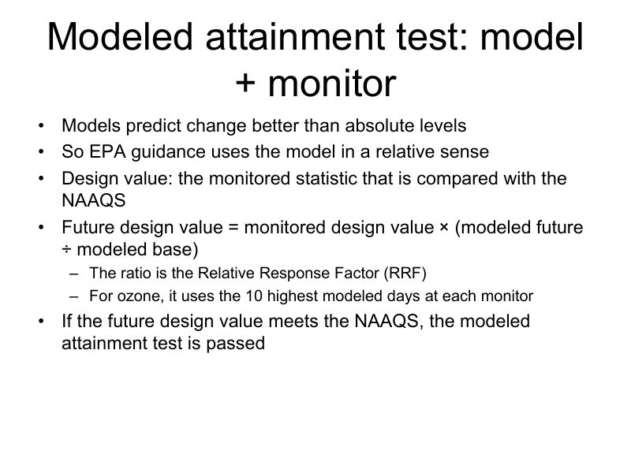

## PDF page 22

Source locator: `ENV5128-09-airqualitymodels`, PDF p. 22.

Printed slide number candidate: not identified (use PDF page as canonical locator).

Generated navigation topics: Ozone and atmospheric chemistry, Climate and environmental effects, Policy and management context

Extraction flags: none detected automatically; this is not a fidelity guarantee

### Extracted source text

> Florida case: regional haze plan
> •
> Goal: restore natural visibility in Class I areas
> •
> Florida’s plan relied on regional photochemical modeling by
> VISTAS, the Southeast states’ group
> •
> Finding: SO2 is still the main cause of haze on the 20% most
> impaired days
> •
> So the plan focused on SO2 sources
> – 11 Florida facilities and 2 out of state selected for review
> •
> EPA approved the plan in June 2025
> •
> Commenters argued the model underpredicted sulfate: model
> performance is part of the debate

### Original page appearance

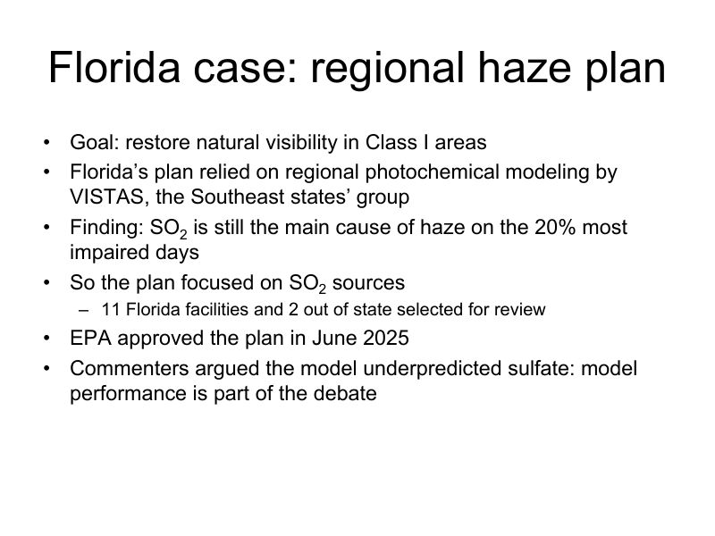

## PDF page 23

Source locator: `ENV5128-09-airqualitymodels`, PDF p. 23.

Printed slide number candidate: not identified (use PDF page as canonical locator).

Generated navigation topics: Ozone and atmospheric chemistry, Policy and management context

Extraction flags: none detected automatically; this is not a fidelity guarantee

### Extracted source text

> Whose pollution is it? Interstate
> transport
> •
> “Good neighbor” provision: a state may not significantly contribute to
> nonattainment in another state
> •
> EPA’s 4-step framework starts with photochemical modeling
> – Step 1: identify downwind monitors projected to have nonattainment or
> maintenance problems
> – Step 2: identify upwind states that contribute above a screening threshold
> •
> Long-used threshold: 1% of the standard (0.70 ppb for ozone)
> •
> The model result decides who is regulated, so it is heavily litigated
> – 2023 Good Neighbor Plan: stayed by the Supreme Court, June 2024

### Original page appearance

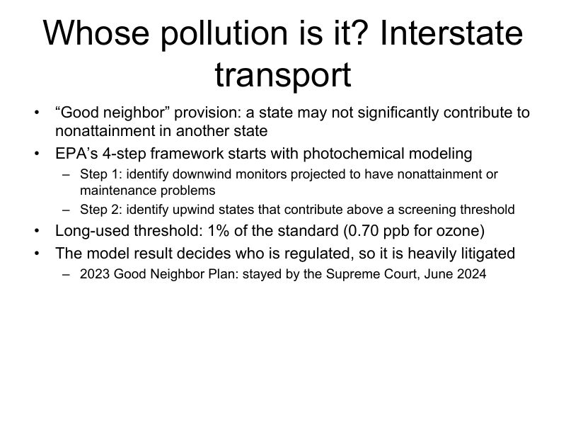

## PDF page 24

Source locator: `ENV5128-09-airqualitymodels`, PDF p. 24.

Printed slide number candidate: not identified (use PDF page as canonical locator).

Generated navigation topics: Pollution sources and emissions, Exposure and health, Policy and management context

Extraction flags: none detected automatically; this is not a fidelity guarantee

### Extracted source text

> From concentrations to health
> benefits
> •
> Recall cost-benefit analysis
> •
> Photochemical model output (CMAQ or CAMx) is fed into
> EPA’s BenMAP-CE tool
> •
> BenMAP combines the change in concentration with
> population and health data
> – Output: avoided deaths and illnesses, and their dollar value
> •
> Used in Regulatory Impact Analyses for national rules
> •
> Shortcut for quick estimates: “benefit per ton” of emissions
> reduced

### Original page appearance

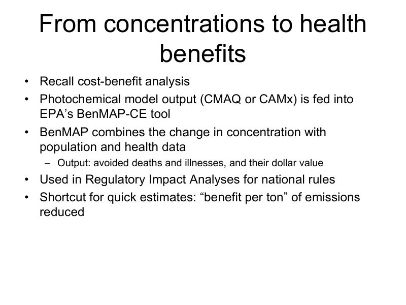

## PDF page 25

Source locator: `ENV5128-09-airqualitymodels`, PDF p. 25.

Printed slide number candidate: not identified (use PDF page as canonical locator).

Generated navigation topics: Dispersion and Gaussian models, Exposure and health, Ozone and atmospheric chemistry

Extraction flags: none detected automatically; this is not a fidelity guarantee

### Extracted source text

> Air toxics screening:
> AirToxScreen
> •
> Replaced NATA (Lecture 1)
> •
> Combines two models
> – CMAQ (photochemical): regional chemistry and transport
> – AERMOD (dispersion): fine detail near sources
> •
> Estimates cancer and other health risks, down to census blocks
> from the 2020 assessment
> •
> A screening tool: shows where to look more closely
> – Not for pinpointing risk at one location
> – Not the sole basis for a regulation

### Original page appearance

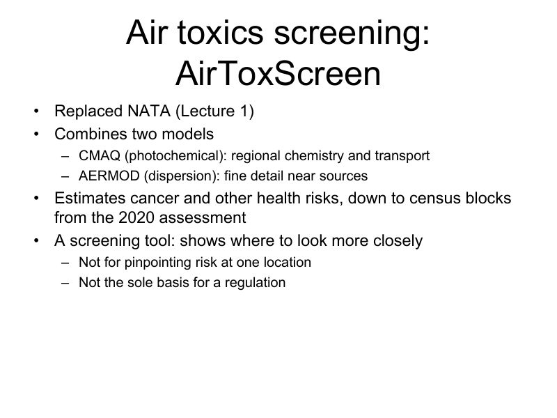

## PDF page 26

Source locator: `ENV5128-09-airqualitymodels`, PDF p. 26.

Printed slide number candidate: not identified (use PDF page as canonical locator).

Generated navigation topics: Pollution sources and emissions, Monitoring networks and siting, Particles and aerosols

Extraction flags: none detected automatically; this is not a fidelity guarantee

### Extracted source text

> Forecasting: what will the air be
> like tomorrow?
> •
> NOAA has issued national air quality forecast guidance since
> 2004
> •
> Current system (May 2024): a photochemical model, with
> meteorology and CMAQ chemistry run together
> – Forecasts ozone, PM2.5 and wildfire smoke
> •
> State and local forecasters use it to issue AQI forecasts on
> AirNow
> •
> Known weak spot: PM2.5 near and downwind of wildfires
> •
> AirNow Fire and Smoke Map adds low-cost sensor data between
> monitors

### Original page appearance

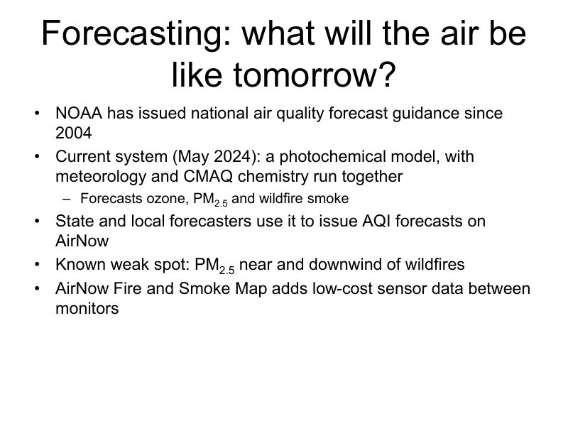

## PDF page 27

Source locator: `ENV5128-09-airqualitymodels`, PDF p. 27.

Printed slide number candidate: not identified (use PDF page as canonical locator).

Generated navigation topics: Pollution sources and emissions, Particles and aerosols, Ozone and atmospheric chemistry

Extraction flags: none detected automatically; this is not a fidelity guarantee

### Extracted source text

> Photochemical models:
> strengths and limits
> •
> Strengths
> – Full chemistry: ozone and secondary PM2.5
> – Any number of sources, from a region to a continent
> – Can test “what-if” control strategies
> •
> Limits
> – One average value per grid cell: misses near-source hot spots
> – Costly; needs a specialist team
> – Depends on the quality of the emissions inventory
> – Results are often contested

### Original page appearance

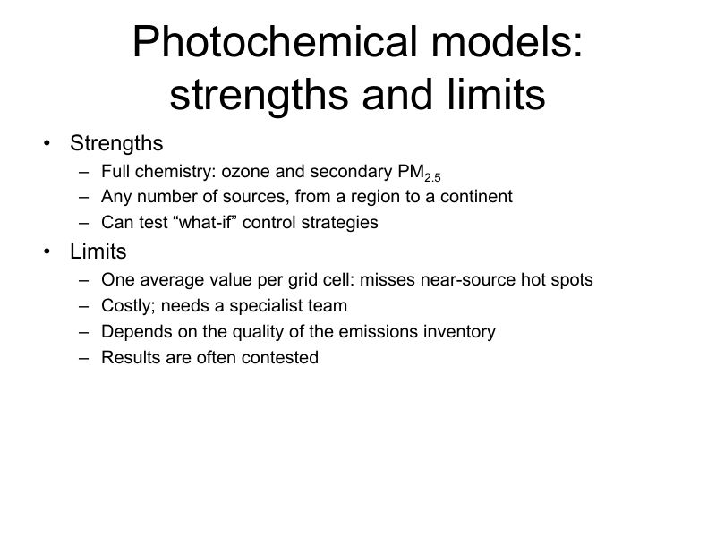

## PDF page 28

Source locator: `ENV5128-09-airqualitymodels`, PDF p. 28.

Printed slide number candidate: not identified (use PDF page as canonical locator).

Generated navigation topics: Pollution sources and emissions, Particles and aerosols, Model inputs preprocessing and operation

Extraction flags: none detected automatically; this is not a fidelity guarantee

### Extracted source text

> Which sources caused what we
> measured?
> •
> Receptor models start from measurements at a monitor (the
> receptor), not from emissions
> •
> Each source type leaves a chemical “fingerprint” (source
> profile) in the particles
> •
> Data: PM composition from CSN and IMPROVE (Lecture 2)
> •
> Two common EPA tools
> – Chemical Mass Balance (CMB): source profiles are known in advance
> – Positive Matrix Factorization (PMF): source profiles are derived from
> many ambient samples
> •
> No meteorological data or emissions inventory needed

### Original page appearance

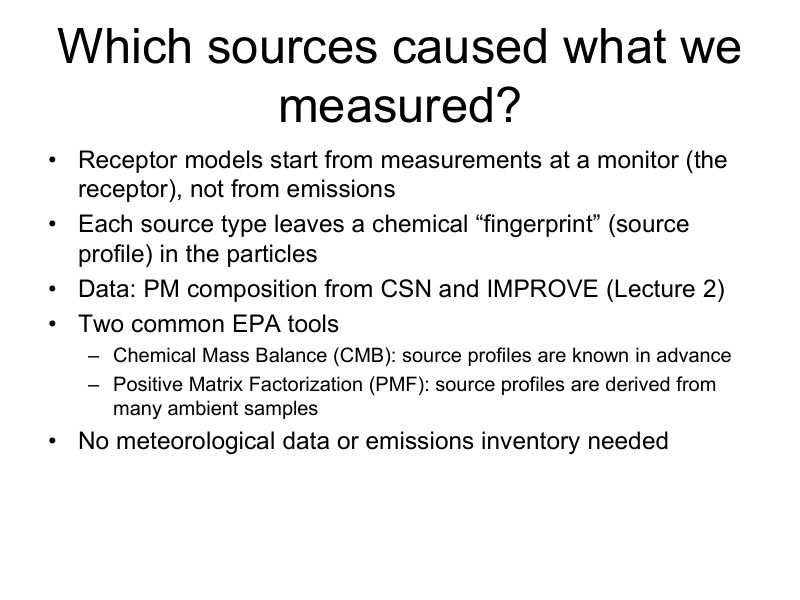

## PDF page 29

Source locator: `ENV5128-09-airqualitymodels`, PDF p. 29.

Printed slide number candidate: not identified (use PDF page as canonical locator).

Generated navigation topics: Particles and aerosols, Model inputs preprocessing and operation

Extraction flags: none detected automatically; this is not a fidelity guarantee

### Extracted source text

> Receptor models: the mathematics
> •
> PMF
> •
> Both source profiles (fij) and
> source contributions (Sj) are
> unknown
> •
> Solve the MBE using
> constrained, weighted, least-
> squares, factor analytic
> approach.
> – Many samples required
> • A few hundred unknowns
> •
> CMB
> •
> Source profiles (fij) are known
> – Measured from sources
> •
> Solve the MBE using least
> squares method
> – About 20 equations (species)
> in 8 unknowns (sources)
> – Can be done on each sample
> 
> =
> +
> 
> =
> m
> j
> i
> j
> ij
> i
> e
> S
> f
> C
> 1
> •
> Both need speciated particulate matter composition (metals, ions,
> carbon) measured at the receptor. MBE = mass balance equation

### Original page appearance

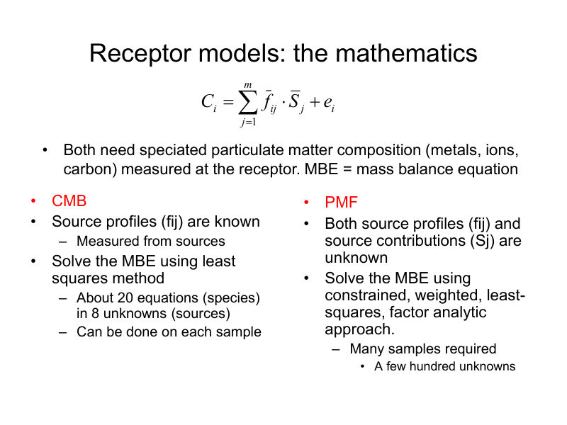

## PDF page 30

Source locator: `ENV5128-09-airqualitymodels`, PDF p. 30.

Printed slide number candidate: 30 (use PDF page as canonical locator).

Generated navigation topics: Pollution sources and emissions

Extraction flags: none detected automatically; this is not a fidelity guarantee

### Extracted source text

> Na
> Mg
> K
> Ca
> Cr
> Mn
> Fe
> Ni
> Cu
> Zn
> Pb
> SO4
> 2-
> NO3
> -
> NH4
> +
> OC
> EC
> 0
> 20
> 40
> 60
> 80
> Secondary sulfate (%)
>   FT
>   FPMF
>   FPTT
> Na
> Mg
> K
> Ca
> Cr
> Mn
> Fe
> Ni
> Cu
> Zn
> Pb
> SO4
> 2-
> NO3
> -
> NH4
> +
> OC
> EC
> 0
> 20
> 40
> 60
> 80
> Secondary nitrate (%)
> Na
> Mg
> K
> Ca
> Cr
> Mn
> Fe
> Ni
> Cu
> Zn
> Pb
> SO4
> 2-
> NO3
> -
> NH4
> +
> OC
> EC
> 0
> 10
> 20
> 30
> 40
> 50
> Vehicle exhaust (%)
> Species
> Na
> Mg
> K
> Ca
> Cr
> Mn
> Fe
> Ni
> Cu
> Zn
> Pb
> SO4
> 2-
> NO3
> -
> NH4
> +
> OC
> EC
> 0
> 10
> 20
> 30
> 40
> Coal combustion (%)
> Na
> Mg
> K
> Ca
> Cr
> Mn
> Fe
> Ni
> Cu
> Zn
> Pb
> SO4
> 2-
> NO3
> -
> NH4
> +
> OC
> EC
> 0
> 10
> 20
> 30
> 40
> Dust (%)
> Example: chemical
> fingerprints (source
> profiles) of five sources
> found by PMF
> • Dust
> • Coal combustion
> • Secondary sulfate
> • Secondary nitrate
> • Vehicle exhaust

### Original page appearance

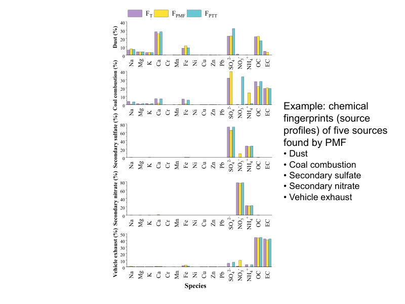

## PDF page 31

Source locator: `ENV5128-09-airqualitymodels`, PDF p. 31.

Printed slide number candidate: not identified (use PDF page as canonical locator).

Generated navigation topics: Pollution sources and emissions, Particles and aerosols

Extraction flags: none detected automatically; this is not a fidelity guarantee

### Extracted source text

> Example: Port of Tacoma,
> Washington (2023)
> •
> State study of PM2.5 at a monitor next to a major container
> port
> •
> PMF applied to 187 CSN samples, 2018–2022
> •
> Ten source factors explained 90% of the PM2.5 mass
> •
> Largest contributor to annual PM2.5: wood smoke
> – Also dominated the highest winter days
> •
> Diesel-related factors together: about 29%
> •
> Results point controls toward the sources that matter most

### Original page appearance

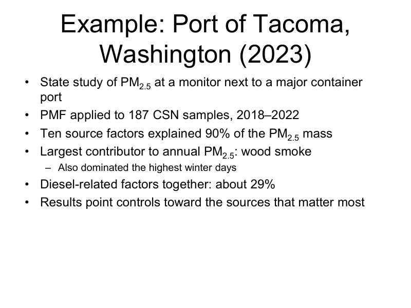

## PDF page 32

Source locator: `ENV5128-09-airqualitymodels`, PDF p. 32.

Printed slide number candidate: not identified (use PDF page as canonical locator).

Generated navigation topics: Pollution sources and emissions, Measurement methods and instruments, Model inputs preprocessing and operation

Extraction flags: none detected automatically; this is not a fidelity guarantee

### Extracted source text

> Receptor models: strengths and
> limits
> •
> Strengths
> – Based on real measurements
> – Independent check on emission inventories
> – Relatively inexpensive
> •
> Limits
> – Describes only the receptor (monitor) location
> – Cannot predict the effect of future controls
> – Secondary PM (sulfate, nitrate) is hard to trace to a source
> – Needs many samples with full chemical composition

### Original page appearance

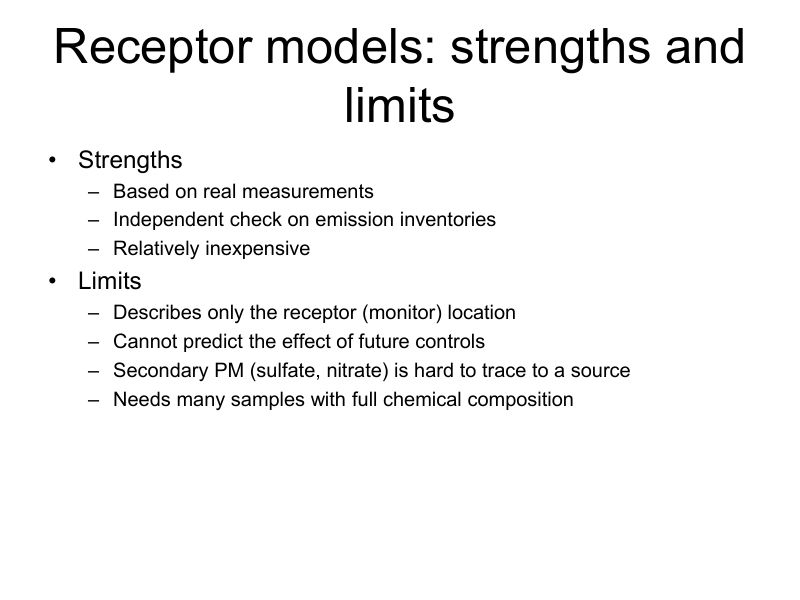

## PDF page 33

Source locator: `ENV5128-09-airqualitymodels`, PDF p. 33.

Printed slide number candidate: not identified (use PDF page as canonical locator).

Generated navigation topics: Dispersion and Gaussian models, Particles and aerosols, Ozone and atmospheric chemistry

Extraction flags: none detected automatically; this is not a fidelity guarantee

### Extracted source text

> Which model for which
> question?
> Dispersion
> Photochemical
> Receptor
> Question
> What does this source
> add nearby?
> What happens to the region if
> emissions change?
> Which sources caused
> what we measured?
> Scale
> Near-field, up to 50 km
> (AERMOD)
> Urban to continental
> One monitor site
> Pollutants
> Primary (directly
> emitted): SO2, NO2, CO,
> PM
> Ozone, secondary PM2.5,
> haze
> PM with measured
> composition
> Needs
> Source data,
> meteorological data
> Full emissions inventory,
> meteorological model
> Many speciated samples
> Examples
> AERMOD, CALPUFF
> CMAQ, CAMx
> CMB, PMF
> Typical use
> NSR/PSD permits, SO2
> plans
> Ozone and PM2.5 SIPs,
> regional haze, interstate
> transport, forecasts
> Identifying sources to
> control

### Original page appearance

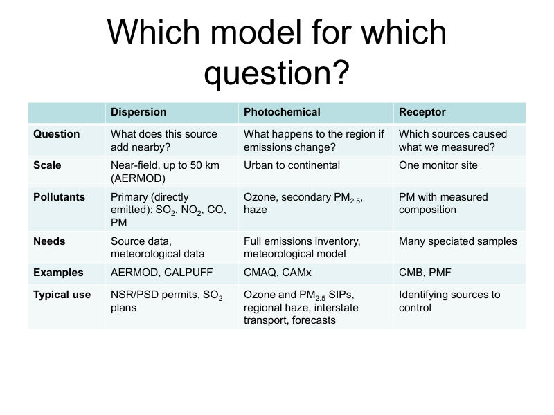

## PDF page 34

Source locator: `ENV5128-09-airqualitymodels`, PDF p. 34.

Printed slide number candidate: not identified (use PDF page as canonical locator).

Generated navigation topics: Pollution sources and emissions, Sensors calibration and data quality, Model inputs preprocessing and operation

Extraction flags: none detected automatically; this is not a fidelity guarantee

### Extracted source text

> How much should a decision-
> maker trust a model?
> •
> Ask how well it matched monitors for a past period (model
> performance evaluation)
> •
> Prefer relative answers (change) over absolute numbers
> •
> Check the inputs: emissions are often the largest uncertainty
> •
> Use more than one line of evidence
> – Models, monitors and receptor analysis together: “weight of evidence”
> •
> Models inform decisions; they do not make them

### Original page appearance

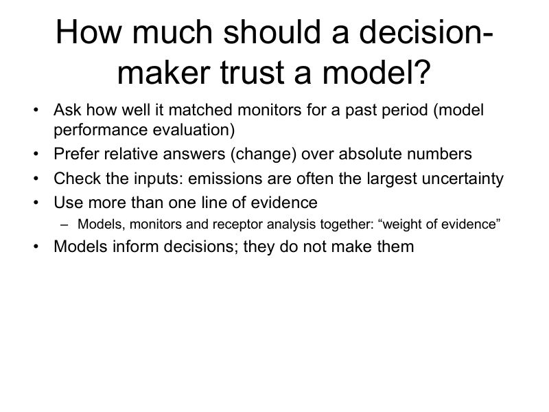

